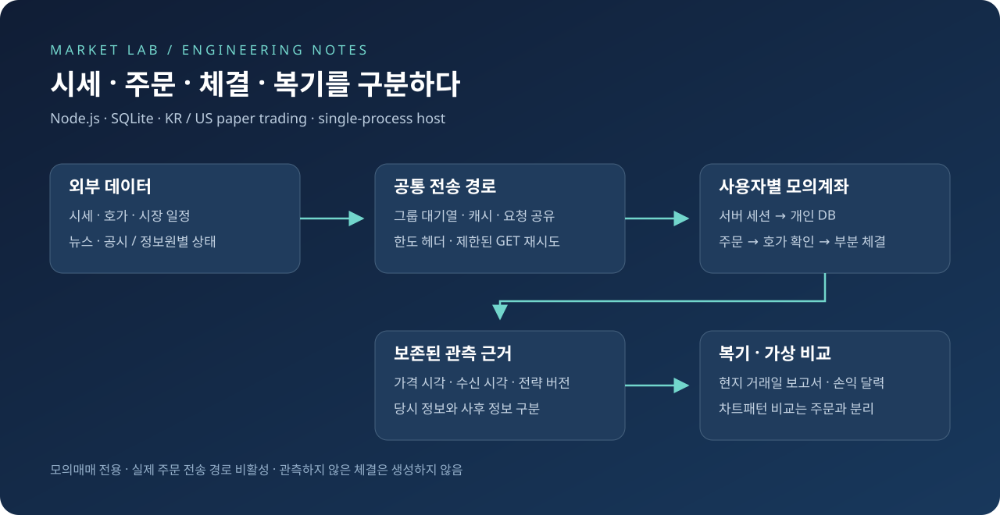

# Market Lab · 마켓랩

**시세를 읽는 것에서 시작해, 주문·체결·복기를 구분하는 모의투자 실험 환경으로.**

토스증권 Open API의 시세와 시장 일정을 사용하는 국내·미국장 모의투자 프로젝트입니다. 신규 분석, 보유 감시, 지정가 대기 주문, 뉴스·공시 반응, 장 마감 복기를 같은 사용자별 기록으로 연결합니다.



## 개발 기록

### [API 호출 제한부터 지정가 모의 체결까지: 마켓랩 개발기](docs/blog/2026-11-26-marketlab-engineering.md)

클라이언트별 지연만으로 해결되지 않았던 호출 제한, 현재가만으로 체결을 만들 때 생기는 문제, 사용자별 기록 분리와 미래 정보를 섞지 않는 복기 설계를 정리했습니다. 구현한 범위와 아직 검증하지 못한 부분을 함께 기록합니다.

[기술 글 목록](docs/blog/README.md) · [호출 제한 대응](docs/api-limits.md) · [주문·비용 모델](docs/paper-v2.md) · [복기와 전략 보완](docs/daily-review.md)

## 현재 구현

| 영역 | 동작 | 코드·운영 기준 |
|---|---|---|
| 시장 운영 | 국내 코스피·ETF, 미국 NASDAQ·NYSE·AMEX 주식·ETF. 시장별 원금 1,000만 원, 미국 거래마다 당시 환율로 원화 정산 | [미국장](docs/us-paper.md) |
| API 전송 | 프로세스 공통 그룹별 대기열, 응답 헤더 기반 감속, 캐시·진행 중 요청 공유, 제한된 GET 재시도 | [전송 모듈](server/market-transport.mjs) |
| 모의 주문 | 일반 매수는 눌림 지정가 대기, 강한 상승세·장중 이벤트는 즉시 체결 우선. 보유분 +5% 사전 매도와 보호 매도 우선 처리 | [모의 체결](server/paper-model.mjs) |
| 계정 | 초대 가입, 서버 세션 인증, 사용자별 DB·API 연결·모의계좌 분리 | [계정 경계](docs/accounts.md) |
| 정보 반응 | 장중 뉴스 2분·공시 1분·공식 발표 5분. 신규 중요 정보에 최대 2분당 1회 추가 분석 | [정보 수집](docs/market-events.md) |
| 일별 복기 | 현지 거래일 손익 달력, 당시 판단·비용·사후 관측 비교, 근거가 있을 때 제한된 진입 기준 보완 | [복기](docs/daily-review.md) |
| 패턴 비교 | 저장된 진입 전 자료로 8개 차트패턴의 가상 거래 회피·유지 비교. 주문·전략에는 연결하지 않음 | [분석 범위](docs/chart-patterns.md) |

## 구조

Node.js 24 이상, JavaScript ES modules, SQLite, Web Crypto, 기본 웹 API와 HTML/CSS/JavaScript를 사용합니다. 별도 패키지 설치 단계는 없습니다.

- `server/main.mjs`: 데이터 API와 분석·감시 실행, 상태 저장.
- `server/local-host.mjs`, `local-accounts.mjs`, `local-tenants.mjs`: 로컬 인증과 사용자별 실행 환경.
- `server/market-transport.mjs`, `toss.mjs`, `us-paper.mjs`: 외부 데이터 호출과 후보 평가.
- `server/paper-model.mjs`: 주문·부분 체결·비용·만료 처리.
- `server/daily-review.mjs`, `strategy-policy.mjs`: 관측 근거·보고서·다음 거래일 보완.
- `server/chart-patterns.mjs`: 주문 경로와 분리된 패턴 가상 비교.
- `web/`: 대시보드, 주문 기록, 매매 복기, 차트패턴 화면.

## 실행과 검증

```sh
node --test
node scripts/build.mjs
node scripts/local.mjs --preview
```

`--preview`는 자동 배치를 끈 실행입니다. 로그인 초기화와 API 연결은 [실행·운영 안내](docs/local-running.md), [계정 안내](docs/accounts.md)를 따릅니다. 자동 모의매매를 운영할 때는 `node scripts/local.mjs`로 실행합니다. 공개 저장소에는 개인 API 자격정보·DB·거래 기록을 포함하지 않습니다.

테스트는 가짜 토큰과 응답을 사용합니다. 호출 제한·사용자 격리·시장 일정·체결 비용·부분 체결·사후 비교의 미래 정보 배제·실제 주문 차단을 확인하며, 실제 주문의 성공이나 투자 수익성을 검증하는 테스트는 아닙니다.

## 해석할 때의 경계

현재 운영 경로는 **모의매매 전용**입니다. `server/live/`의 별도 준비 소스는 실행 서버·배치·빌드에 연결하지 않았습니다. [분리 기준](docs/live-trading.md)을 확인하세요.

모의 체결은 관측 시점의 호가와 제한된 잔량을 사용합니다. 거래소의 대기 순번·숨은 유동성·감시 사이의 가격 경로·모든 세금과 제비용을 재현하지 않습니다. 계좌별 종목 비중 상한이 없어 자금 집중도 가능합니다. 장 마감 보완은 제한된 규칙 변경이며 수익성이 입증된 학습 모델은 아닙니다.

SEC·BLS RSS는 2026-11-26 운영 환경에서 403 차단이 확인됐습니다. BLS 공식 수치 API의 별도 조회는 성공했으나 앱의 RSS 대체 경로로 통합하지 않았습니다. 정보원 장애를 ‘관련 공시 없음’으로 표시하지 않습니다.

토스증권의 공식 제품이나 제휴 서비스가 아닌 개인 프로젝트입니다. 기획·운영 요구사항을 바탕으로 Codex와 협업해 구현·검증·문서화하고 있습니다. 기술 글의 내용은 공개된 코드와 테스트를 기준으로 작성했습니다.
