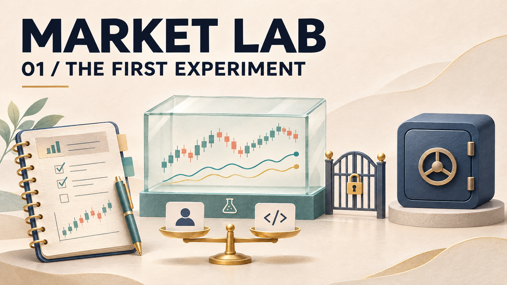
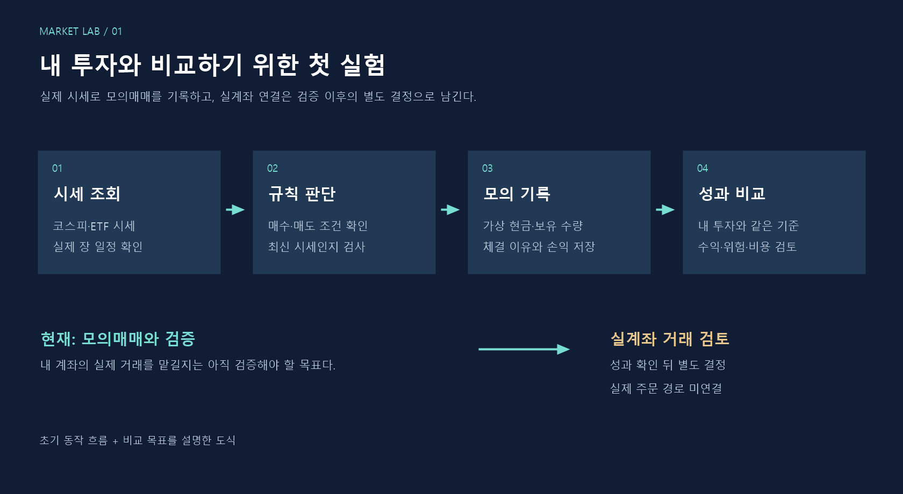

# [마켓랩 01] 모의투자가 나보다 잘한다면, 내 계좌를 맡겨볼 수 있을까?

마켓랩을 시작한 이유는 단순했다.

**모의투자 프로그램의 성과가 내가 직접 투자한 결과보다 좋다면, 나중에는 실제 계좌의 거래도 맡겨보고 싶었다.**

그래서 첫 단계로 모의투자를 골랐다. 실제 시세를 읽고 정해둔 규칙에 따라 매매를 기록하면서, 이 프로그램이 어느 정도의 결과를 내는지 확인할 수 있는 환경부터 만들기로 했다. 내 계좌를 맡기는 일은 그 결과를 본 뒤 판단할 문제로 남겼다.

이 글은 그 출발점에 대한 기록이다. 초기 구현 범위는 2026년 11월 25일의 첫 커밋을 기준으로 정리했다. 이후에 추가한 미국장, 더 잦은 감시와 매매 복기는 처음부터 있던 기능으로 설명하지 않는다.

*기획 의도를 표현한 AI 생성 일러스트다. 이미지 속 차트는 실제 투자 성과가 아니다.*

## 먼저 답을 얻고 싶었던 질문

프로그램을 만들었다는 사실보다 궁금했던 것은 결과였다. 정해진 조건을 계속 확인하고, 그 조건이 맞으면 기록하는 방식이 내 판단보다 나은 성과를 낼 수 있을까?

다만 처음부터 그 답을 알고 있었던 것은 아니다. 모의투자 성과가 더 좋다는 결과도 아직 없다. 그래서 이 프로젝트의 시작을 ‘거래를 맡길 시스템 완성’이 아니라, **거래를 맡겨도 될지 판단할 실험을 만드는 단계**로 잡았다.

단순히 매수·매도 신호를 찍는 화면으로는 부족했다. 얼마를 가지고 시작했고, 무엇을 보유하고 있으며, 왜 매매했고, 그 결과 자산이 어떻게 달라졌는지가 남아야 했다. 그래야 나중에 결과를 비교하거나 규칙을 다시 살펴볼 수 있다.

## 첫 버전은 한 달짜리 국내장 실험이었다

처음부터 현재의 기능을 모두 넣지는 않았다. 첫 구현은 국내 코스피·ETF 시세를 읽고 가상 계좌의 거래와 평가를 기록하는 형태였다. 시작과 끝을 정해 두고 운영해 보는 캠페인으로 구성했다.

| 항목 | 첫 구현의 기준 |
|---|---|
| 대상 | 국내 코스피 종목과 ETF |
| 가상 시작 자금 | 1,000만 원 |
| 운영 기간 | 2026년 11월 25일~12월 24일 |
| 동시 보유 | 최대 5종목 |
| 신규 매수 비중 | 당시 평가자산의 종목당 20% 이하 |
| 실행 | 한국시간 09~16시 정시 확인, 16시는 평가 |

당시 손절은 매수가 대비 −2.5%, 익절은 +5%를 기준으로 두었다. 직전 시간보다 가격이 약해진 경우도 매도 조건에 포함했다. 이 수치들은 초기 실험의 설정이지, 성과가 입증된 최적값이라는 뜻은 아니다.

첫 버전의 비용 가정은 수수료와 거래세가 0원이었다. 그만큼 초기 결과를 실제 계좌 성과와 그대로 비교하기에는 한계가 있었다. 비용과 호가 기반 모의 체결은 이후 개발에서 보완했다. 위 표의 비중 상한과 실행 주기도 현재 설정과 구분해서 읽어야 한다.

## 시세를 읽는 부분과 돈이 움직이는 부분을 나눴다

토스증권 Open API는 시장 자료를 읽는 데 사용하고, 모의 계좌의 현금·보유 수량·거래 기록은 프로그램 안의 원장에 남기도록 했다.

화면에서 매수가 기록되더라도 실제 계좌에 주문이 들어가는 구조는 아니다. 실제 시세를 읽었다는 사실과 실제 주문을 실행했다는 사실을 구분하는 것이 필요했다. 그렇지 않으면 실험을 보고 있는지 계좌가 움직이고 있는지부터 혼동하게 된다.

*시세 조회·규칙 판단·모의 기록은 초기 동작이며, 내 투자와의 비교와 실계좌 거래 검토는 그 기록으로 확인하려는 목표다. 비교 자동화가 처음부터 구현됐다는 의미는 아니다.*

시세를 받으면 거래 가능한 장인지와 자료가 충분히 최신인지 확인하고, 매매 조건을 검사한다. 조건에 따라 가상 현금과 보유 수량을 바꾸고 거래 이유와 손익을 기록한다. 화면은 그 기록을 다시 읽어 보여주는 역할을 맡는다.

나중에 실계좌 연결용 준비 소스도 추가했지만, 현재 운영 경로에는 연결하지 않았다. 실제 계좌를 맡기고 싶다는 처음의 의도와, 지금 실제 거래가 실행되고 있는지는 다른 이야기다.

## 나보다 잘한다는 것을 무엇으로 볼 것인가

처음의 동기는 ‘성과가 더 좋으면 맡겨보고 싶다’였지만, 비교 기준까지 다 정해진 상태로 시작한 것은 아니다. 실제로 운영하려면 같은 기간을 비교하는지, 중간에 추가한 자금은 어떻게 처리하는지부터 맞춰야 한다.

수익률만 좋아 보이고 손실 폭이 훨씬 크다면 그 결과를 어떻게 받아들일지도 판단해야 한다. 수수료와 세금, 체결되지 못한 주문을 제외한 숫자라면 실제 계좌와의 차이도 크다.

그래서 기록이 중요해졌다. 결과뿐 아니라 그 결과를 만든 매매 이유와 비용, 적용한 규칙이 남아 있어야 한다. 이후에 보완한 체결 비용, 위험 통계, 전략 버전과 매매 복기도 이 비교를 더 설명할 수 있게 만드는 방향으로 이해하고 있다.

이 글에는 내 실제 계좌 내역이나 모의투자가 나보다 잘했다는 비교 결과를 넣지 않았다. 아직 확인하지 않은 결론을 먼저 쓰고 싶지는 않다.

## 기획에서 개발로 넘어가며

구현은 기획과 운영 요구사항을 정리하고 Codex와 협업해 진행했다. 코드가 만들어졌다는 사실만으로 동작을 확인한 것으로 보지는 않았다. 실제 실행과 테스트, 화면 확인을 거치면서 다음에 고칠 부분을 정했다.

프로그램이 결과를 남기기 시작하면 질문도 구체적으로 바뀐다. 감시를 더 자주 하면 판단이 달라질까? 현재가에 주문한 것으로 기록해도 될까? 같은 종목을 여러 번 거래했다면 하루의 판단을 어떻게 복기할까?

처음부터 필요한 기능을 모두 알았던 것은 아니다. 다만 출발점은 분명하다. **내 투자와 비교할 만한 기록을 먼저 만들고, 그 기록이 설득력이 있을 때 다음 단계를 생각하는 것.** 마켓랩은 지금 그 실험을 진행하는 중이다.

---

### 이어서 읽기

- [차트 개선기: 5초마다 시세를 받아도 차트가 이상했던 이유](https://velog.io/@kkd9013/marketlab-devlog-2026-11-26)
- [프로젝트 저장소](https://github.com/Kimkideok-Duke/kospi-paper-lab)
- [첫 구현의 README](https://github.com/Kimkideok-Duke/kospi-paper-lab/blob/075876e93f7a068ff5ac056b8229f0f56b007cc9/README.md)
- [초기 매매·원장 규칙](https://github.com/Kimkideok-Duke/kospi-paper-lab/blob/075876e93f7a068ff5ac056b8229f0f56b007cc9/server/engine.mjs)

*2026년 11월 27일, 초기 코드와 기획 의도를 돌아보며 작성했다. 표지는 AI 생성 이미지이며 흐름도는 기획 설명용으로 제작했다.*
