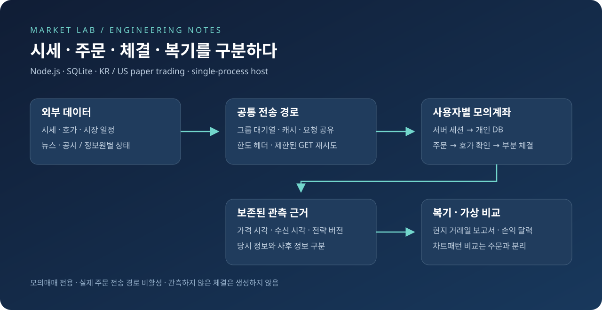
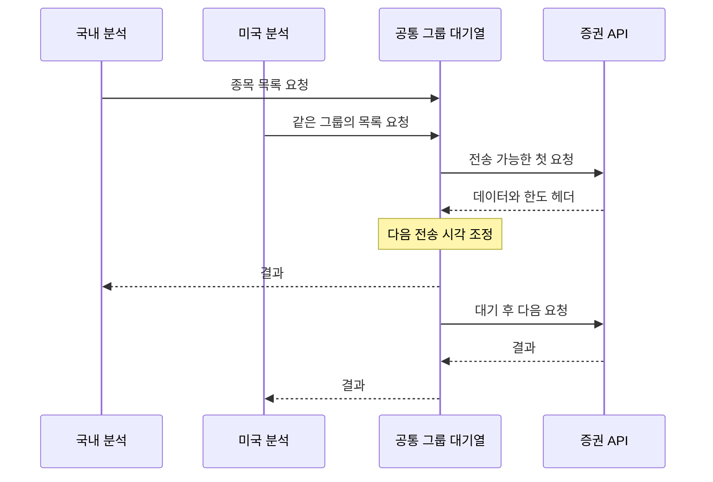
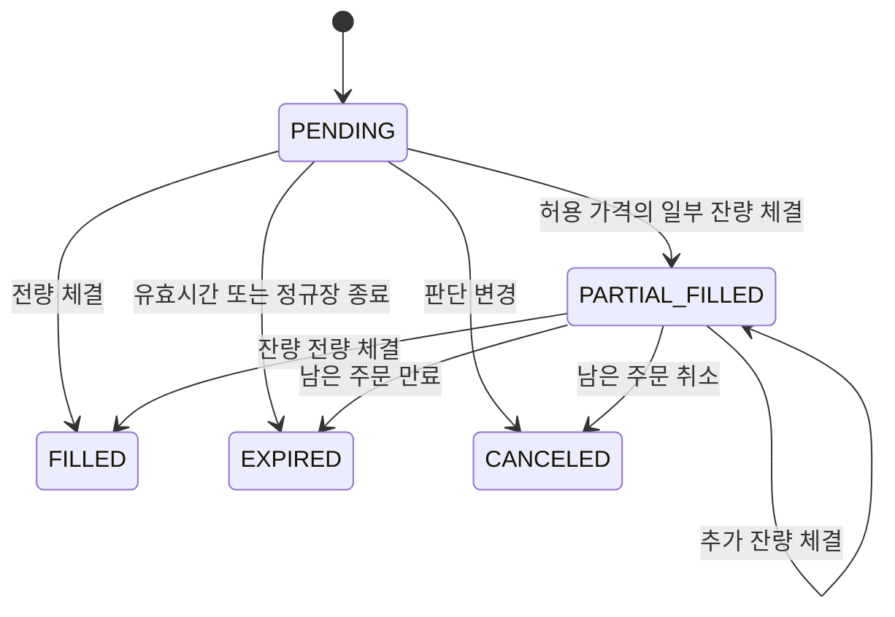

# API 호출 제한부터 지정가 모의 체결까지: 마켓랩 개발기

2026-11-26 · Node.js · SQLite · 증권 API · 모의 주문 · 운영 기록

시세를 가져와서 매수 조건을 검사하는 코드는 비교적 단순하다. 그런데 실제 데이터를 계속 받아 두 시장을 동시에 관찰하고, 여러 기기에서 같은 기록을 열어 보고, 다음 날의 판단까지 이어가려면 질문이 달라진다.

요청을 보냈는데 응답을 받지 못했다면 다시 보내도 될까? 현재가가 목표가를 지나갔다면 주문이 체결됐다고 기록해도 될까? 오늘 결과를 보고 규칙을 바꿨을 때 과거 거래의 설명은 그대로 남아 있을까?

마켓랩은 이런 질문을 확인하기 위해 만든 개인 모의투자 프로젝트다. 토스증권 Open API에서 국내·미국장 시세와 시장 일정을 읽고, 주문과 체결은 내부 모의 원장에 기록한다. 신규 분석은 10분, 보유 종목과 미체결 주문 감시는 1분 간격이다. 국내장과 미국장에는 각각 별도의 가상 원금 1,000만 원을 두고, 미국 거래는 체결 시점 환율로 원화 정산한다.

이 글에서는 수익률 대신 구현 중 실제로 바뀐 설계를 정리한다. 설명의 기준은 현재 공개 소스이며, 실제 주문 전송은 운영 경로에 연결하지 않았다.



## 1. 호출 제한은 클라이언트 인스턴스 밖에서 관리해야 했다

초기에는 외부 호출 사이에 지연을 넣으면 충분하다고 생각하기 쉬웠다. 하지만 국내 분석, 미국 분석, 보유 감시가 각자 클라이언트를 만들면 각 인스턴스가 간격을 지켜도 같은 API 그룹에 요청이 겹칠 수 있다.

실제로 종목 목록 조회에서 한도 오류가 발생했다. 당시 클라이언트별 350ms 간격으로 목록을 읽었지만 `STOCK_ALL` 응답의 허용량은 초당 1회였다. 목록 수집이 끝나지 않아 다음 분석에서도 조회가 반복되는 문제가 있었다. 이 조사와 수정 기준은 [호출 한도 문서](../api-limits.md)에 남겼다.

토스증권의 [공식 개요](https://openapi.tossinvest.com/openapi-docs/overview.md)는 제한을 클라이언트와 API 그룹 단위로 설명하고, 현재 허용량은 응답 헤더로 확인하도록 안내한다. 따라서 호출하는 함수별 지연이 아니라 전송 경로를 함께 묶을 필요가 있었다.

현재 [market-transport.mjs](../../server/market-transport.mjs)는 프로세스 전체에서 그룹별 대기열을 공유한다.



`X-RateLimit-Limit`가 더 낮게 오면 간격을 늘린다. 잔여량이 0이면 재충전 시각까지 그룹 전체가 기다린다. 429에서는 `Retry-After`, 재충전 시간, 지수 백오프 중 긴 시간을 적용하고 작은 지터를 더한다. GET 재시도는 최대 세 번의 시도로 제한하고 대기 예산을 넘기면 분석을 중단한다. 토큰 발급 POST에는 같은 재전송 규칙을 적용하지 않는다.

불필요한 요청 자체도 줄였다. 같은 인증 맥락의 동일 GET은 진행 중인 요청을 공유하고, 종목 목록은 더 오래 캐시한다. 현재가와 호가는 짧게 캐시하되 실제 체결 판단에서 시각을 다시 검사한다. 캐시 적중만으로 데이터가 충분히 최신이라고 간주하지 않는다.

화면 조회도 분리했다. 휴대폰이나 PC에서 화면을 새로 읽는 요청은 서버 감시가 저장한 시세를 반환한다. 화면 수가 늘 때마다 증권 API 호출이 늘지 않게 한 것이다.

이 구조의 경계는 **한 프로세스**다. 다른 PC나 별도 프로그램이 같은 자격정보로 소비하는 호출량까지 조절하지는 못한다. 여러 서버로 확장한다면 공유 토큰·한도 조정자를 별도로 설계해야 한다.

검증: [그룹별 직렬화·헤더 감속·429·요청 공유 테스트](../../test/market-transport.test.mjs).

## 2. ‘가격에 도달했다’와 ‘체결됐다’를 다른 사건으로 다뤘다

현재가와 목표가를 비교한 뒤 즉시 잔고를 바꾸는 모의매매는 구현하기 쉽다. 그러나 매수하려는 수량을 그 가격에 실제로 살 수 있었는지는 설명하지 못한다.

[paper-model.mjs](../../server/paper-model.mjs)는 주문을 먼저 만들고 별도 호가 검사를 거쳐 체결을 생성한다. 주문에는 기준가, 지정가, 주문 수량, 누적 체결 수량, 만료 시각, 전략 버전과 생성 이유를 기록한다.



매수는 매도 호가가 지정가 이하일 때, 매도는 매수 호가가 지정가 이상일 때만 체결을 검토한다. 체결가 데이터는 90초, 호가는 30초 이내여야 한다. 호가 잔량은 기본 10%만 사용하며 같은 종목·방향·가격·호가 시각의 사용량을 기록해 한 스냅샷을 반복 소비하지 않는다.

현재 주문 방식은 두 가지를 병행한다.

| 상황 | 모의 주문 방식 |
|---|---|
| 일반적인 신규 매수 후보 | 분석 기준가보다 기본 0.20% 낮은 지정가에 최대 15분 대기 |
| 최근 분봉 상승률 1% 이상이며 뉴스 주의가 없는 후보, 또는 장중 이벤트 추가 분석 | 가격 여유를 둔 즉시 체결 우선 지정가 |
| 보유 종목의 이익 실현 | 다음 감시부터 평균 매수가 대비 +5% 목표가에 당일 매도 주문 유지 |
| 손절·악재·단기 추세 약화 | 목표가 주문 잔량을 취소하고 보호 매도 우선 |

대기 매수에는 현금과 종목 슬롯을 예약한다. 체결 시에도 다른 매수 주문의 예약금을 고려한다. 미국장은 당시 유효 환율과 비용을 다시 계산하므로 환율 변동으로 현금이 부족하면 주문량 전부가 체결된 것으로 만들지 않는다.

현금에서 차감하는 매수액은 거래금액에 수수료와 해당 환전 비용을 더한 값이다. 매도 입금액은 거래금액에서 수수료·해당 거래세·환전 비용을 뺀 값이다. 슬리피지는 호가 체결가에 이미 반영된 기준가 대비 가격 차이이므로 현금에서 한 번 더 차감하지 않는다.

이 모델도 실제 거래소는 아니다. 대기 순번과 숨은 유동성, 감시 사이의 체결 경로, 모든 호가 단위와 세금·제비용을 재현하지 않는다. 특히 **감시 사이에 목표가를 통과했을 것이라는 추정만으로 체결을 만들지 않는다.** 이 한계를 명시하는 것이 모의 수익률 숫자를 늘리는 것보다 중요했다.

검증: [부분 체결·비용·만료·목표가와 보호 매도 테스트](../../test/paper-model.test.mjs), [비용과 주문 정책](../paper-v2.md).

## 3. 시장 일정과 환율은 보조 정보가 아니라 실행 조건이었다

국내장에 미국장을 추가하면서 타이머만 하나 더 만드는 것으로는 충분하지 않았다. 한국 날짜와 뉴욕 거래일이 다르고, 서머타임과 휴장·조기 폐장도 있기 때문이다.

[us-engine.mjs](../../server/us-engine.mjs)와 [us-batch.mjs](../../server/us-batch.mjs)는 거래소 캘린더의 개장·종료 시각과 뉴욕 현지 거래일을 사용한다. 개장 3분 뒤 첫 분석을 하고 이후 개장 기준 10분 회차를 만든다. 서버가 놓친 회차를 과거 시세로 소급 체결하지 않는다.

미국장의 원화 평가손익에는 주가와 환율이 함께 들어간다. 따라서 달러 주가의 손절 판단과 원화 계좌의 평가를 구분했다. 주가는 그대로인데 환율만 바뀌었다고 달러 주가 손절이 발생해서는 안 된다. 반대로 실제 모의 체결에서는 유효한 당시 환율이 필요하며, 없으면 거래를 보류한다.

성과 화면에서는 주가 기여, 환율 기여와 비용·반올림 잔차를 구분해 보여준다. 이는 제한된 내부 모의계좌의 손익 분해이며 세무 계산 전체를 대체하지 않는다.

검증: [뉴욕 날짜·조기 폐장·환율·원화 반올림 테스트](../../test/us-paper.test.mjs), [미국장 운영 기준](../us-paper.md).

## 4. 여러 기기에서 같은 기록을 보는 문제와 여러 사용자의 기록을 나누는 문제

PC와 휴대폰에서 접속하더라도 같은 사용자는 서버에 저장된 같은 기록을 본다. 여기서 사용자를 늘리면 별도의 경계가 필요하다. 화면에 계정 이름을 표시하는 것만으로 다른 사람의 API 연결과 거래 내역이 분리되지는 않는다.

로컬 호스트는 [local-accounts.mjs](../../server/local-accounts.mjs)에서 세션을 확인하고, [local-tenants.mjs](../../server/local-tenants.mjs)에서 서버가 정한 사용자 ID에 맞는 실행 환경을 선택한다. 외부 요청이 넘긴 사용자 ID로 DB를 고르지 않는다.

사용자마다 SQLite 파일과 API 연결·국내/미국장 상태를 분리했다. 비밀번호는 개별 salt와 scrypt 해시로 저장하고, 세션·초대 토큰도 해시를 저장한다. API 자격정보는 암호화하고 사용자별 암호화 키는 서버 마스터 키에서 파생한다. 쿠키에는 HttpOnly·SameSite=Strict를 적용하며 HTTPS 게이트웨이 경로에는 Secure를 추가한다. 상태 변경에는 출처 검사를 사용한다.

이 로그인은 마켓랩 자체 계정이다. 토스 앱 비밀번호를 받는 소셜 로그인이나 실계좌 소유권 검증을 구현한 것은 아니다. 또한 서버 운영자는 파일과 마스터 키를 통제한다. 웹 사용자 사이의 분리를 운영자로부터의 암호학적 비공개라고 설명해서는 안 된다.

저장 방식도 단순하게 유지했다. 모의계좌 상태와 거래 기록을 JSON으로 직렬화해 SQLite에 저장한다. 금융기관의 복식부기 원장이나 위변조 방지 감사 저장소를 구현한 것은 아니다. 향후 조회량과 이력이 커지면 거래·주문·관측값을 분리한 스키마, 복구 검증과 보존 정책이 필요하다.

검증: [위조 헤더·사용자 간 접근·세션 폐기·이전 데이터 보존 테스트](../../test/accounts.test.mjs), [계정 경계](../accounts.md).

## 5. 수집 실패와 ‘새로운 공시가 없음’을 같은 상태로 두지 않았다

뉴스를 자주 확인하는 기능에서는 정상일 때보다 실패했을 때의 의미가 중요했다. 새 항목이 없는 것과 피드 자체에 접근하지 못한 것은 서로 다르다.

[market-events.mjs](../../server/market-events.mjs)는 정보원별 확인 시각, 성공·실패·접근 차단 상태와 재확인 시각을 유지한다. 공개 피드는 프로세스 공통 캐시와 진행 중 요청을 공유하고 같은 호스트 요청도 분산한다. 최초 조회는 기준 목록을 만들며 오래된 항목에 뒤늦게 매매로 반응하지 않는다. 사용자별 처리 이력으로 중복 반응도 막는다.

분류는 제목의 명시적인 표현을 사용하는 규칙이다. 공시 본문이나 기사 전문을 이해하는 언어 모델로 설명하지 않는다. 불분명한 제목은 중립으로 두고, 호재의 매수 점수에는 공식 공시 또는 서로 다른 언론 정보원의 교차 확인을 요구한다. 이후에도 시세·분봉·호가·현금 검사를 거친다.

실제 운영 환경에서는 SEC와 BLS RSS가 403을 반환했다. 운영자 연락 정보를 선언한 재시험에서도 RSS 접근은 복구되지 않았다. 별도 BLS 공식 수치 API에서는 CPI·비농업 고용·실업률 조회가 성공했지만, 아직 앱의 RSS 대체 수집으로 통합하지 않았다. 수치 시계열 API가 발표 속보와 같은 시점에 갱신된다고 가정하지도 않았다.

장애를 숨기고 정상이라고 표시하기보다 확인된 정보원과 확인되지 않은 정보원을 화면에서 구분했다. 접근 제한은 우회하지 않고 공식 경로와 정책을 확인했다. [정보원별 운영 제한](../market-events.md), [SEC 접근 안내](https://www.sec.gov/about/webmaster-frequently-asked-questions), [BLS API 한도](https://www.bls.gov/developers/api_faqs.htm)를 참고했다.

검증: [피드 파싱·신선도·중복·장애 대기·추가 분석 테스트](../../test/market-events.test.mjs).

## 6. 복기는 당시의 판단과 나중에 알게 된 사실을 나누는 작업이었다

매매 복기 메뉴에는 거래일별 손익 달력과 마감 보고서가 있다. 달력의 평가손익은 전 기록일 대비 평가자산의 변화이고, 상세 보고서의 실현손익은 그날 매도 체결에 저장된 손익이다. 두 숫자를 같은 수익으로 표시하지 않았다.

보고서는 실제 장 전체 종료 후 여유 시간을 두고 작성한다. 한국 연속매매 종료와 정규장 전체 종료를 구분하고, 미국은 뉴욕 거래일과 조기 폐장을 반영한다. 마감 시세를 확보하지 못하면 마지막 관측값을 썼다는 사실을 표시한다. 완성된 보고서는 재조회로 덮어쓰지 않는다.

사후 대안은 저장된 자료 안에서만 계산한다. 체결 5~7분 뒤의 관측값이 있을 때 같은 수량의 가격 차이를 참고액으로 보여준다. 미국장은 체결 당시 환율을 고정한다. 이 값은 그 가격에 같은 수량을 체결할 수 있었다는 뜻도, 당시 예측할 수 있었다는 뜻도 아니다.

전략 보완 역시 자유로운 자동 최적화로 만들지 않았다. 완결 매매의 표본이 충분할 때만 최소 상승세와 허용 호가 간격 두 항목을 검토하며, 회당 변화는 0.05%p로 제한한다. 부분 체결 여러 건을 독립적인 성공 사례 여러 개로 세지 않는다. 근거가 부족하면 규칙을 유지한다.

변경을 예약한 뒤 다음 실제 거래일의 개장 전 적용 구간에서 한 번만 반영한다. 변경 전후 값과 근거 보고서를 기록하고 대기 매수를 취소하지만, 과거 체결·현금·보유분을 새 규칙에 맞춰 고치지는 않는다.

검증: [마감·중복 작성·사후 비교·표본 집계·다음 거래일 적용 테스트](../../test/daily-review.test.mjs), [보완 범위](../daily-review.md).

## 7. 차트패턴 비교는 주문 경로에서 분리했다

이중바닥·이중천장, 머리어깨와 역머리어깨, 삼각수렴과 쐐기의 돌파를 진입 전 자료로 비교하는 기능도 추가했다. 핵심 질문은 ‘패턴이 있었으니 수익이 났다’가 아니라 ‘이 필터를 적용했다면 비교 가능한 기존 거래 중 무엇을 회피했을까’였다.

[chart-patterns.mjs](../../server/chart-patterns.mjs)는 주문 실행과 전략 정책을 가져오지 않는 순수 분석 모듈이다. 조회 API는 로그인한 사용자의 저장된 상태만 읽고 외부 시세 호출이나 원장 수정을 하지 않는다.

분석은 첫 매수부터 전량 매도까지를 하나의 묶음으로 본다. 유지한 거래에는 기존 비용·환율이 반영된 저장 실현손익을 쓰고, 회피한 거래의 가상 손익은 0으로 둔다. 회피한 자금의 재투자, 새로운 매매, 다른 청산 시점을 만들어내지 않는다. 따라서 계좌 전체를 재실행한 백테스트라고 부르지 않는다.

봉은 종료 시각과 수신 시각을 확인하고 진입 이후 자료를 제외한다. 당시 자료가 부족한 거래는 분석 불가로 남긴다. 기능 도입 이전 기록을 사후 재구성한 경우에도 출처와 당시 수신 시각의 불확실성을 표시한다. 예쁜 패턴 그림을 보여주는 것보다 미래 정보가 들어가지 않게 경계를 정하는 일이 먼저였다.

검증: [8개 유형·미완성 봉·미래 자료·자료 공백·부분 체결 묶음 테스트](../../test/chart-patterns.test.mjs), [가상 비교의 한계](../chart-patterns.md).

## 8. 지금 검증한 것과 다음에 검증할 것

게시 시점인 2026-11-26에 Node.js 기본 테스트 러너로 전체 83개 테스트의 통과와 빌드 성공을 확인했다. 테스트에는 가짜 토큰과 응답을 사용한다.

```sh
node --test
node scripts/build.mjs
```

호출 제한과 그룹 공유, 사용자 간 접근 차단, 휴장·조기 폐장, 신선하지 않은 가격의 체결 방지, 부분 체결과 현금 정산, 미래 정보 배제, 실제 주문 경로의 차단을 확인한다. 테스트 통과가 실제 체결 품질이나 수익성, 보안 감사를 대신하지는 않는다.

앞으로 확인할 항목은 명확하다. 더 긴 기간과 여러 시장 상황에서의 비용 반영 성과, 단일 프로세스 밖의 토큰·호출량 조정, 대량 이력의 저장 구조, 서버 중단·복구와 백업 복원의 반복 검증이다. 실거래는 별도 문제다. 준비 소스는 [server/live/](../../server/live/)에 분리돼 있지만 서버·배치·빌드에는 연결하지 않았고 실제 계좌로 검증하지 않았다.

시세를 읽는 함수에 기능을 계속 붙이는 대신 데이터 수집, 주문 의도, 체결, 평가와 사후 분석을 나눠 보니 실패의 위치와 의미를 설명하기 쉬워졌다. 마켓랩의 다음 변경도 이 구분을 유지하면서 기록할 예정이다.

---

[프로젝트와 실행 방법](../../README.md) · [소스](../../server/) · [테스트](../../test/) · [개발 기록 목록](README.md)

이 글은 2026-11-26 공개 소스와 검증 기록을 바탕으로 작성했다. 마켓랩은 토스증권의 공식 제품이나 제휴 서비스가 아닌 개인 프로젝트이며, Codex와 협업해 구현·검증·문서화하고 있다. 개인 계좌 기록·API 자격정보·운영 접속 주소는 공개 글에 포함하지 않았다.

