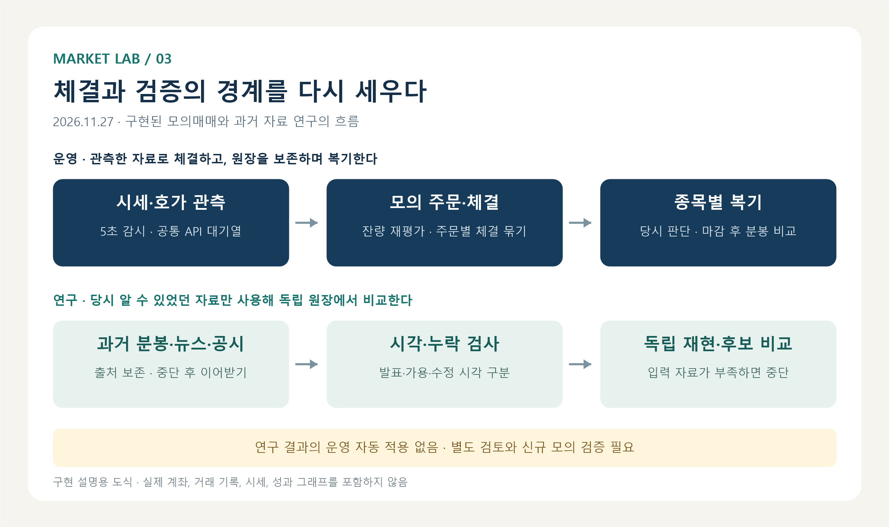

# [마켓랩 03] 한 주씩 반복되던 매도에서, 검증 가능한 모의매매로

2026-11-27 개발 기록 · 2026-11-28 작성 · Node.js · 모의 체결 · 매매 복기 · 과거 자료 검증

같은 종목의 매도가 한 주씩 반복해서 보였다. 화면에는 같은 판단 이유가 여러 줄 쌓였고, 그 기록만으로는 주문을 작게 나눈 것인지, 한 주문이 나뉘어 체결된 것인지 읽기 어려웠다. 차트를 정리한 다음에도 모의매매의 동작을 설명할 일이 남아 있었다.

마켓랩을 시작한 이유는 모의투자 성과가 내 투자보다 좋으면 실제 계좌 거래도 맡겨볼 수 있을지 확인하기 위해서였다. 그 비교를 하려면 종목 선택뿐 아니라 체결을 어떻게 가정했는지, 뒤늦게 본 가격을 당시 판단과 섞지 않았는지부터 설명할 수 있어야 한다. 이날 작업은 체결 처리와 복기를 보완하고, 과거 자료로 전략을 검증할 준비를 하는 쪽으로 이어졌다.

*실제 구현을 바탕으로 코드로 제작한 설명용 도식이다. 연구 실행기는 자료가 부족하면 중단하며, 결과를 운영 전략에 자동 적용하지 않는다. 계좌·시세·성과 자료는 포함하지 않았다.*

## 한 주씩 보인 매도에는 체결 방식과 표시 방식이 함께 얽혀 있었다

기존 모의 체결은 관측한 호가 잔량의 일부만 사용하는 보수적인 가정을 두고 있었다. 유동성을 과장하지 않으려는 장치였지만, 보호 매도에도 같은 비율을 적용하면 청산해야 할 잔량이 잘게 남을 수 있었다. 가격이 내려간 뒤에도 이전 지정가를 유지하면 새 매수호가에서는 잔량이 체결되지 않는 문제도 있었다.

손절·악재 대응·추세 약화에 따른 보호 매도는 관측한 매수호가 잔량을 전부 사용할 수 있도록 바꿨다. 새 호가가 들어오고 조건을 충족하면 잔량의 지정가를 다시 평가한다. 일반 매수와 익절에는 기존 잔량 참여 비율을 유지하고, 같은 시각·가격의 호가에서 이미 사용한 수량은 차감한다. 같은 잔량을 여러 번 체결한 것처럼 계산하지 않기 위해서다.

그렇다고 보유량을 한 번에 모두 팔았다고 기록하지는 않는다. 실제 관측한 상위 다섯 호가와 잔량 안에서만 모의 체결하며, 거래 정지나 부족한 유동성은 여전히 미체결로 남을 수 있다. 이 변경은 거래소 주문 대기열을 그대로 재현한 것이 아니라 기존 모의 체결 가정을 보완한 것이다.

화면도 주문 단위로 바꿨다. 같은 주문의 체결은 수량과 금액, 기록된 비용과 실현손익을 합치고 가중평균 체결가를 보여준다. 상세를 펼치면 원래 체결을 다시 선택할 수 있다. 요약 화면을 정리하면서도 개별 체결 기록을 보존하는 방식이다.

구현과 검증: [보호 매도·주문별 표시 변경](https://github.com/Kimkideok-Duke/kospi-paper-lab/commit/6a44611), [체결 모형](https://github.com/Kimkideok-Duke/kospi-paper-lab/blob/928bd0a/server/paper-model.mjs), [주문별 체결 묶기](https://github.com/Kimkideok-Duke/kospi-paper-lab/blob/928bd0a/web/trade-groups.mjs).

## 손절 폭을 바꾸면서 주문 크기도 다시 계산했다

체결 방식을 손보는 것과 손실 위험을 줄이는 것은 별도로 검토했다. 먼저 신규 주문에 종목별 비중, 전체 투자 비중, 한 번의 거래에서 감수할 손실 예산을 함께 적용했다. 이미 대기 중인 매수 주문의 예약금과 왕복 비용도 계산에 넣어 같은 현금을 중복 배정하지 않도록 했다.

이후 사용자 요청으로 종목 손절 기준을 −2.5%에서 −7%로 변경했다. 청산 기준 숫자만 바꾸면 같은 수량에서 예상 손실이 커질 수 있어, 수량 계산에도 새 손절 폭을 반영했다. 코드의 손실 예산은 0.35%를 유지하고 손절 폭과 비용을 분모에 넣으므로, 다른 조건이 같으면 새 주문에 배정되는 금액은 줄어든다.

계좌의 일손실 기준은 신규 매수를 멈추는 장치로 두었다. 그 기준에 도달했다는 이유만으로 모든 보유 종목을 강제 청산하지 않는다. 종목 손절 외의 악재·추세 약화 보호 매도도 계속 사용하므로 손절 폭을 넓힌 것이 모든 종목을 그 지점까지 기다린다는 뜻은 아니다.

이 값들은 사용자 선택과 구현된 위험 관리 가정이다. 더 좋은 수익률이 검증된 최적값으로 소개하지 않는다. 경계값 검증은 정확히 −7%에 도달했을 때의 판단, 부동소수점 오차, 이전 손절 주문의 미체결 잔량 재평가를 포함했다. 과거 체결은 수정하지 않는다.

관련 변경: [위험 예산과 매수 중지](https://github.com/Kimkideok-Duke/kospi-paper-lab/commit/455546a), [손절 폭과 주문 크기 정합성](https://github.com/Kimkideok-Duke/kospi-paper-lab/commit/b98a3c9).

## 매도한 다음 가격을 보되, 당시 판단을 사후 가격으로 덮지 않기

보유 감시만으로는 매도 뒤의 가격 경로가 충분히 남지 않을 수 있다. 그래서 정규장이 끝난 뒤 그날 거래한 종목의 1분봉을 별도로 보완하도록 했다. 한 번에 처리할 종목 수와 요청 예산을 제한하고, 확인하지 못한 구간은 다음 유지관리에서 이어서 조회한다.

복기에서는 체결 뒤 5분·15분·30분 가격과 이후 확인된 고저가, 마지막 분봉을 비교한다. 체결이 걸쳐 있는 분봉은 비교에서 제외한다. 그 봉의 고가가 체결 전인지 후인지 알 수 없는데, 전부 매도 뒤에 얻을 수 있었던 가격처럼 취급하지 않기 위해서다.

나중에 더 좋은 가격이 나왔더라도 그것을 실행 가능한 대안 수익으로 합산하지 않는다. 당시 호가·수량·비용과 재진입 가능성을 함께 재현하지 않았기 때문이다. 차트에서는 개별 매매 판단을 찾고, 하루의 복기에서는 같은 종목을 왜 거래했고 어떤 관측이 남았는지 종합해서 읽도록 했다.

관련 변경: [마감 후 분봉 보완](https://github.com/Kimkideok-Duke/kospi-paper-lab/commit/c95f937), [사후 비교 계산](https://github.com/Kimkideok-Duke/kospi-paper-lab/blob/928bd0a/server/day-chart-review.mjs), [검증 코드](https://github.com/Kimkideok-Duke/kospi-paper-lab/blob/928bd0a/test/day-chart-review.test.mjs).

## 외부에 보여줄 화면은 저장된 원장의 허용 필드로 만들었다

외부 관람 요청에는 관리 대시보드를 그대로 공개하는 대신 별도 페이지와 게이트웨이를 만들었다. 공개 응답은 허용한 필드로 새 객체를 만들고, 로그인·설정·내부 API 경로는 관람 게이트웨이에서 차단한다. 관람 쿠키로 관리 API를 호출할 수 없도록 권한도 나눴다.

관람 요청은 저장된 관측을 읽는다. 브라우저가 늘었다고 증권사 API를 더 호출하지 않도록 공통 캐시를 두고 활성 관람 세션과 갱신 빈도를 제한했다. 그래프의 도움말도 이미 전달한 자료에서 실제 관측 지점을 선택하며, 관측하지 않은 중간 금액을 새로 만들어 보여주지 않는다.

접속 호환성 문제는 한 번의 정상 응답으로 해결됐다고 판단하지 않았다. HEAD 응답과 읽기 요청 처리, 빈 요청 본문 구분 등을 보완하고 진단 기록을 추가했다. 변경 기록에는 보완 뒤 사용자 브라우저에서 화면이 열리고 자료 요청도 성공했다는 확인이 남아 있다. 이전 실패의 단일 원인까지 확정한 것은 아니다.

관련 변경: [익명 관람 분리](https://github.com/Kimkideok-Duke/kospi-paper-lab/commit/03a1c31), [호환성 진단](https://github.com/Kimkideok-Duke/kospi-paper-lab/commit/77b7939), [그래프 도움말](https://github.com/Kimkideok-Duke/kospi-paper-lab/commit/3715f86).

## 백테스트보다 먼저 만든 것은 자료를 검사하고 이어받는 절차였다

다음 요청은 5월 이후 코스피 자료로 현재 전략을 검증하는 것이었다. 당시 뉴스·공시와 필요할 때 차트 패턴도 참고해야 했다. 하지만 지금 읽을 수 있는 기사에 과거 날짜만 붙이거나 현재 상장 종목만으로 당시 전체 시장을 구성하면 결과가 왜곡될 수 있다.

연구 자료에는 발표 시각, 실제 가용 시각, 사용한 버전의 시각을 나눠 넣었다. 판단 시점 뒤의 정보는 제외하고, 당시 종목 구성과 뉴스·공시의 수집 범위가 확인되지 않으면 전체 재현을 중단한다. 커뮤니티와 X 자료도 원문·게시 시각·본인 여부 등을 확인해야 하는 별도 근거로 두었으며 실시간 주문 신호에 연결하지 않았다.

분봉 확보 경로를 다시 조사하면서 기존 토스 연결부터 사용할 수 있다는 점도 확인했다. 로컬 수집 화면을 추가하고 현재 코스피 목록의 과거 1분봉을 페이지 단위로 저장하도록 했다. 기존 유효 토큰과 공통 API 대기열을 사용하며 페이지마다 진행 상태를 남겨 브라우저 종료나 오류 이후에도 이어받을 수 있다. 인증 오류가 나면 중단하며, 연구 수집 때문에 별도 토큰을 발급하지 않는다.

이 수집은 현재 목록을 기준으로 한다. 상장폐지 종목, 당시 전체 구성과 과거 호가 등은 별도 보완이 필요하다. 원시 페이지의 경계 중복도 가져오기 단계에서 제거해야 한다. 따라서 분봉 조회가 끝났다는 표시만으로 당시 시장 전체를 재현했다고 판단하지 않는다.

기존 모의 엔진을 독립 원장에서 실행하는 연구 코드와 18개 조건 조합의 비교 실행기도 추가했다. 학습·후보 선정·별도 평가 기간을 나누고 자동 운영 승격은 두지 않았다. **전체 전략 백테스트와 최적 알고리즘 선정은 아직 완료되지 않았다.** 자료를 더 모으고 당시 시점의 입력을 검증해야 하는 단계다.

관련 변경: [당시 시점 근거 검사와 독립 연구](https://github.com/Kimkideok-Duke/kospi-paper-lab/commit/3b22413), [웹 근거 수집](https://github.com/Kimkideok-Duke/kospi-paper-lab/commit/fcc832e), [인증된 분봉 이어받기](https://github.com/Kimkideok-Duke/kospi-paper-lab/commit/928bd0a). 상세 절차는 [연구 문서](https://github.com/Kimkideok-Duke/kospi-paper-lab/blob/928bd0a/docs/strategy-research.md)에 기록했다.

## 확인한 결과와 남은 검증

이 글은 한국 시간 **2026-11-27 00:00 이상, 2026-11-28 00:00 미만**의 커밋을 대상으로 한다. 총 24개 커밋 중 `server/`, `web/`, `scripts/`, `test/`, `research/`의 실제 소스를 바꾼 커밋은 13개다. 문서·이미지·공개 일지 게시만 한 커밋은 소스 변경 집계에서 제외했다. 설명의 기준 소스는 [928bd0a](https://github.com/Kimkideok-Duke/kospi-paper-lab/commit/928bd0a)다.

당일 변경 기록에는 기능 추가 시점별 검증 결과가 남아 있다. 이번 글 작성 중에는 같은 최종 소스를 빌드한 뒤 키 없는 전체 검증을 다시 실행해 **144개 테스트가 모두 통과**했다. 이 결과는 체결·위험 예산·계정 경계·재개 동작 등의 코드 검증이며 수익 개선을 입증한 결과는 아니다.

| 이번에 확인한 동작 | 근거 |
|---|---|
| 보호 매도 잔량 재평가·같은 호가 잔량 중복 사용 차단·손절 경계 | [paper-model.test.mjs](https://github.com/Kimkideok-Duke/kospi-paper-lab/blob/928bd0a/test/paper-model.test.mjs) |
| 주문별 체결 합산·원래 체결 보존 | [trade-groups.test.mjs](https://github.com/Kimkideok-Duke/kospi-paper-lab/blob/928bd0a/test/trade-groups.test.mjs) |
| 마감 분봉 보완·거래가 걸친 봉 제외·자료 부족 처리 | [day-chart-review.test.mjs](https://github.com/Kimkideok-Duke/kospi-paper-lab/blob/928bd0a/test/day-chart-review.test.mjs) |
| 공개 필드·접속 제한·관람과 관리 권한 분리 | [public-watch.test.mjs](https://github.com/Kimkideok-Duke/kospi-paper-lab/blob/928bd0a/test/public-watch.test.mjs) |
| 미래 정보·수정된 자료 제외와 수집 중단·재개·기존 토큰 재사용 | [research-evidence.test.mjs](https://github.com/Kimkideok-Duke/kospi-paper-lab/blob/928bd0a/test/research-evidence.test.mjs), [local-research.test.mjs](https://github.com/Kimkideok-Duke/kospi-paper-lab/blob/928bd0a/test/local-research.test.mjs) |

이번 예약 작업에서는 개인 원장·시세 원문을 읽거나 매매를 수동 실행하지 않았고 운영 소스도 수정하지 않았다. 실제 주문 코드는 계속 비활성이다. 변경 이후의 투자 성과와 수집 자료의 전체성은 후속 관측과 별도 검증으로 확인할 항목으로 남겨 둔다.

[이전 편: 5초마다 시세를 받아도 차트가 이상했던 이유](https://velog.io/@kkd9013/marketlab-devlog-2026-11-26) · [시리즈의 출발점: 기획 의도](https://velog.io/@kkd9013/marketlab-01-planning-intent) · [당일 변경 기록](https://github.com/Kimkideok-Duke/kospi-paper-lab/blob/928bd0a/docs/changes/2026-11-27.md) · [도식 제작 정보](https://github.com/Kimkideok-Duke/kospi-paper-lab/blob/main/docs/assets/marketlab-2026-11-27-images.md)
