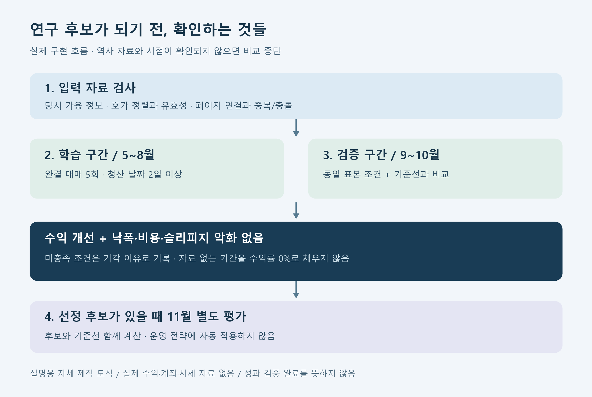

# 백테스트 수익률을 고르기 전에, 통과 기준부터 고쳤다

2026-11-28 개발 기록 · 2026-11-29 작성 · 마켓랩 개발기 04

전날에는 과거 분봉을 모으고 전략을 비교할 실행기를 만들었다. 다음 단계는 더 높은 수익률을 찾는 일이었지만, 먼저 실행기가 무엇을 성공으로 세는지 확인해야 했다. 부분 매도를 여러 번 기록한 결과가 충분한 거래 경험으로 인정되고 있었다.

마켓랩은 모의투자가 내 투자보다 좋은 성과를 낸다면 실제 계좌 거래도 맡길 수 있을지 확인하려고 시작했다. 그 비교의 근거가 되는 백테스트에서 표본과 비용을 잘못 세면, 결과 숫자가 커져도 다음 결정을 내릴 수 없다. 이날은 운영 전략을 바꾸기보다 연구 결과의 통과 조건과 입력 자료 검사를 보완했다.

코드로 제작한 설명용 도식. 자료가 부족하면 비교를 중단하고, 조건을 통과한 연구 후보도 운영에 자동 적용하지 않는다. 실제 계좌·시세·성과는 포함하지 않았다.

## 매도 주문 다섯 개가 거래 다섯 번은 아니었다

기존 후보 검사는 검증 기간에 매도 주문이 다섯 개 이상 있는지 확인했다. 하지만 한 보유분을 여러 차례 나눠 팔아도 매도 주문 수는 늘어난다. 독립적으로 충분히 매매했다는 근거로 사용하기에는 맞지 않는 단위였다.

이미 구현한 완결 매매 계산을 연구 실행기에서도 사용하도록 했다. 매수한 수량을 청산한 흐름을 기준으로 세고, 수량 연결이 잘못됐거나 매도 실현손익이 기록되지 않은 경우는 제외한다. 학습 기간과 검증 기간 모두 완결 매매 다섯 회 이상, 청산이 발생한 날짜 두 날 이상을 요구한다.

회귀 검증에는 매도 주문이 백 개여도 완결 매매가 없는 경우를 넣었다. 이 경우와 청산 날짜가 하루뿐인 경우 모두 후보를 통과시키지 않았다. 최소 표본 조건을 갖췄다는 것이 통계적으로 충분하다는 뜻은 아니지만, 부분 청산을 반복한 기록만으로 조건을 채우는 오류는 막을 수 있다.

구현: [완결 매매와 후보 조건](https://github.com/Kimkideok-Duke/kospi-paper-lab/blob/0511ae4/research/replay.mjs) · [합성 자료를 사용한 검증](https://github.com/Kimkideok-Duke/kospi-paper-lab/blob/0511ae4/test/research-selection.test.mjs)

## 양의 수익만으로는 기준선보다 나아졌다고 할 수 없었다

기존에는 학습·검증 수익이 양수이고 검증 최대 낙폭이 한도 안에 있는지 확인했다. 같은 자료에서 기존 조건을 그대로 사용한 결과보다 나은지는 검사하지 않았다. 그래서 동일한 자료와 현금 시작 조건으로 기준선을 함께 계산하도록 바꿨다.

후보는 검증 수익이 기준선보다 높아야 한다. 최대 낙폭은 절대 한도와 기준선 양쪽을 넘지 않아야 하고, 명시적으로 지출한 비용과 체결가격에 반영된 슬리피지도 기준선보다 악화되면 기각한다. 조건을 만족하지 못하면 이유를 결과에 남긴다.

슬리피지는 가격에 이미 반영된 효과이므로 수익에서 다시 차감하지 않는다. 유리한 체결에서는 음수가 될 수 있다는 점도 검증에 포함했다. 이번 보완은 실제 비용을 줄였다는 보고가 아니라, 서로 다른 결과를 비교하는 계산 기준을 정리한 것이다.

기준선은 실행 인자로 명시할 수 있게 했다. 비교 기간은 학습 5~8월, 후보 선정 9~10월, 별도 평가 11월로 나누고 후보가 선정될 때 별도 평가 구간의 기준선도 함께 계산한다. 실행기에는 운영 전략으로 자동 승격하는 경로를 두지 않았다.

실행 방법과 자료 조건: [전략 연구 문서](https://github.com/Kimkideok-Duke/kospi-paper-lab/blob/0511ae4/docs/strategy-research.md)

## 같은 호가가 배열 순서 때문에 다른 판단을 만들었다

입력 자료에서도 정합성 문제가 있었다. 연구 실행기는 배열 첫 호가로 매수·매도 가격 간격을 계산했지만, 모의 체결 모형은 호가를 가격순으로 정렬했다. 같은 호가를 다른 순서로 넣은 합성 자료에서 진입 가능 판단이 달라지는 것을 재현했다.

연구용 호가를 먼저 검증하고 정렬해 간격 계산과 체결 모형이 같은 가격을 보도록 했다. 가격과 잔량이 유효하지 않거나 같은 가격 단계가 중복되면 재현을 중단한다. 원본 배열은 수정하지 않는다.

실제로 사용할 잔량이 없는 호가와 매수·매도 가격이 교차한 호가는 현재 모형에서 신규 진입 후보로 인정하지 않는다. 교차 호가가 원천 자료에서 절대 생길 수 없다고 단정한 것은 아니다. 현 체결 모형이 설명할 수 있는 입력 범위를 명확히 한 선택이다.

관련 코드: [호가 정규화와 자료 검사](https://github.com/Kimkideok-Duke/kospi-paper-lab/blob/0511ae4/research/evidence.mjs)

## 분봉을 받는 일과 당시 시장을 재현하는 일 사이

원시 분봉은 페이지를 이어받아 저장한다. 이번에는 이미 저장한 파일을 오프라인으로 읽어 페이지 연결, 요청 범위, 시각 순서, 경계 중복과 값 충돌을 검사하는 도구를 추가했다. 원시 페이지는 보존하고 검사 과정에서 같은 시각의 봉을 구분해 센다.

거래일에 봉이 보이지 않거나 분 사이에 간격이 있어도 바로 수집 실패라고 결론 내리지는 않는다. 아직 수집 중인 구간인지, 상장 시점이나 거래 정지 등 별도 확인이 필요한지 구분해야 한다. 도구는 전체 종목과 당시 시장 구성이 검증됐다는 표시도 만들어내지 않는다.

뉴스·공시 수집에는 날짜를 지정하는 옵션을 넣었다. 필요한 날짜를 보완하면서 기존 날짜의 캐시와 수집 범위 기록을 보존하기 위해서다. 발표 시각을 확인했더라도 당시 원문 버전까지 확인한 것은 아니므로, 나중에 얻은 자료를 과거 판단 근거로 바로 넣지는 않는다.

선택한 평가 기간에 스냅샷이 없으면 수익률을 0%로 채우는 대신 `blocked`로 표시한다. **11월 28일 연구 기록에서 전체 전략 재현은 필요한 당시 자료가 없어 중단 상태였고, 실제 역사 자료를 사용한 전략 조합 실험은 0회였다.** 실행기와 합성 검증을 완성한 사실을 수익 검증 완료로 소개하지 않는다.

자료 검사 도구: [audit-candles.mjs](https://github.com/Kimkideok-Duke/kospi-paper-lab/blob/0511ae4/research/audit-candles.mjs)

## 재개 버튼이 저장 완료보다 먼저 준비되는 순간

전체 테스트를 돌리던 중에는 수집을 중단한 뒤 곧바로 재개하는 검사가 한 번 실패했다. 상태가 `paused`로 바뀌었어도 마지막 진행 상태를 파일에 저장하는 작업과 실행 슬롯 해제가 끝나지 않을 수 있었다. 이 짧은 틈에 재개하면 이미 실행 중이라는 409 응답을 받았다.

마지막 저장과 슬롯 해제가 끝날 때까지 외부에는 진행 중 상태를 유지하도록 보완했다. 사용자가 보는 재개 가능 상태를 실제로 이어받을 수 있는 시점과 맞춘 것이다. 변경 당일 기록에는 진행 중인 수집을 보존하기 위해 서버를 재시작하지 않았으며, 이 서버 변경은 다음 정상 재시작 때 반영한다고 남겼다. 이번 글 게시에서도 서버를 재시작하거나 수집을 조작하지 않았다.

관련 코드와 검증: [수집 상태 처리](https://github.com/Kimkideok-Duke/kospi-paper-lab/blob/0511ae4/server/local-research.mjs) · [중단과 이어받기 테스트](https://github.com/Kimkideok-Duke/kospi-paper-lab/blob/0511ae4/test/local-research.test.mjs)

## 이번에 확인한 범위

집계 범위는 한국 시간 2026-11-28 00:00 이상, 2026-11-29 00:00 미만이다. 그날 커밋 여섯 개 중 실제 소스를 바꾼 커밋은 [0511ae4](https://github.com/Kimkideok-Duke/kospi-paper-lab/commit/0511ae4) 하나였다. 앞선 개발기·이미지·일지를 게시한 문서 변경은 이날 새 기능으로 세지 않았다.

변경 당일 기록에는 키 없는 테스트 150개 통과가 남아 있다. 이번 글 작성 시에도 같은 최종 소스에서 전체 테스트를 다시 실행해 **150개 모두 통과**한 것을 확인했다. 여섯 개의 새 연구 검증은 호가 배열 순서, 잘못된 입력, 완결 매매 표본, 기준선 비교, 비용과 슬리피지, 분봉 경계 중복을 다룬다.

운영 매매 기준과 실제 주문 활성화는 이번 변경 대상이 아니었다. 다음 검증에 필요한 것은 더 많은 수익 숫자보다 당시 자료의 누락과 가용 시각을 설명할 근거다. 자료가 준비된 범위에서 같은 기준선과 비교하고, 설명할 수 없는 구간은 남겨 두기로 했다.

[이전 편: 한 주씩 반복되던 매도에서, 검증 가능한 모의매매로](https://velog.io/@kkd9013/marketlab-devlog-2026-11-27) · [기획 의도](https://velog.io/@kkd9013/marketlab-01-planning-intent) · [당일 변경 기록](https://github.com/Kimkideok-Duke/kospi-paper-lab/blob/0511ae4/docs/changes/2026-11-28.md) · [이미지 제작 정보](https://github.com/Kimkideok-Duke/kospi-paper-lab/blob/main/docs/assets/marketlab-2026-11-28-images.md)
