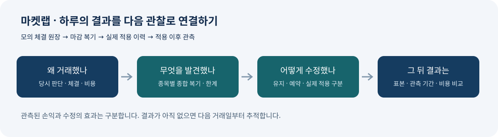

# [마켓랩 모의투자 일지] 2026-11-25 거래·성과와 전략 복기

> 2026-11-25 시장 현지 거래일 기준 모의투자 기록입니다. 캠페인은 2026년 11월 25일~12월 24일이며 국내장·미국장에 각각 1,000만 원으로 시작했습니다. 실계좌 거래나 실제 투자 수익이 아닙니다.

*직접 제작한 설명 도식. 성과 그래프가 아니라 기록의 흐름입니다.*

수익률만 남기면 왜 손익이 달라졌는지 알 수 없습니다. 체결 당시 판단, 마감 복기, 실제 수정 이력, 수정 이후 관측을 한 줄로 이어 기록합니다. 아직 없는 결과는 다음 관찰 과제로 남깁니다.

## 국내장

첫날에는 매수 후 보유한 종목이 중심이었습니다. 매도가 없다는 사실과 손실이 없다는 뜻을 혼동하지 않도록, 보유분도 별도 확인한 종가로 평가했습니다.

| 항목 | 결과 |
|---|---:|
| 당일 체결 | 5건 (매수 5 / 매도 0) |
| 종가 기준 평가액 | 9,803,170원 |
| 당일 평가손익 | -196,830원 (-1.97%) |
| 최초 원금 대비 누적 | -196,830원 (-1.97%) |
| 당일 매도 실현손익 | 0원 |
| 기록된 수수료·세금·환전 비용 | 0원 (상세 미기록 5건) |

종가 확인: 5/5종목, 평가까지 확인 완료. 토스 KRX·NXT 통합 일봉 종가로 시간외장 종료 후 확인했습니다. 평가손익에는 보유분 변동이 포함됩니다. 명시 비용은 이미 체결·현금 정산에 반영된 비용이므로 평가손익에서 다시 빼지 않습니다. 가격에 반영된 슬리피지도 별도 비용처럼 중복 차감하지 않습니다.

### 같은 종목의 반복 거래를 모아 보면

| 종목 | 매수/매도 체결 | 매수/매도 수량 | 매도 실현손익(원) | 기록된 명시 비용(원) |
|---|---:|---:|---:|---:|
| 한진칼 (180640) | 1/0 | 8/0 | 0 | 0 |
| 아시아나IDT (267850) | 1/0 | 145/0 | 0 | 0 |
| 삼성에스디에스 (018260) | 1/0 | 10/0 | 0 | 0 |
| 까뮤이앤씨 (013700) | 1/0 | 1440/0 | 0 | 0 |
| 대한항공우 (003495) | 1/0 | 76/0 | 0 | 0 |

- **한진칼**: 최근 분봉 +1.02% · 호가 간격 0.20% · 외국인·기관 순매도 7,587주 (1건). 당일 매도 실현손익 0원 · 미매도여서 실현 결과 없음.
- **아시아나IDT**: 최근 정기 분석 +3.00% · 최근 분봉 +2.62% · 호가 간격 0.15% · 외국인·기관 순매수 1,390주 (1건). 당일 매도 실현손익 0원 · 미매도여서 실현 결과 없음.
- **삼성에스디에스**: 최근 정기 분석 +0.94% · 최근 분봉 +1.26% · 호가 간격 0.05% · 외국인·기관 순매수 77,441주 (1건). 당일 매도 실현손익 0원 · 미매도여서 실현 결과 없음.
- **까뮤이앤씨**: 최근 정기 분석 +1.91% · 최근 분봉 +2.67% · 호가 간격 0.43% · 외국인·기관 순매수 41,558주 (1건). 당일 매도 실현손익 0원 · 미매도여서 실현 결과 없음.
- **대한항공우**: 최근 정기 분석 +1.96% · 최근 분봉 +2.96% · 호가 간격 0.38% · 외국인·기관 순매도 1,000주 (1건). 당일 매도 실현손익 0원 · 미매도여서 실현 결과 없음.

이유는 체결 당시 저장된 규칙 판단입니다. 사후에 그럴듯한 투자 논리를 덧붙이지 않았습니다. 거래 시각·수량·현지 가격·비용·이유·전략 버전은 [전체 5건 체결 CSV](https://github.com/Kimkideok-Duke/kospi-paper-lab/blob/main/docs/performance/2026-11-25-kr-fills.csv)에서 확인할 수 있습니다. 한국 시간 기준이며, 실계좌 내역은 포함하지 않습니다.

### 복기에서 발견한 문제와 수정 과정

- 완결 매매·거래일 표본이 부족하거나 새 완결 매매가 없어 기존 전략 유지

마감 자동 복기는 **기준 유지**로 기록됐습니다. 완결 매매·거래일 표본이 부족하거나 새 완결 매매가 없어 기존 전략 유지 확인한 완결 매매는 0회, 관측 거래일은 0일입니다. 진입 상승세 기준 0.15% → 0.15%, 최대 호가 간격 0.65% → 0.65%입니다.

해당 날짜를 근거로 한 실제 후속 적용 기록: 0건. 변경 예약·실제 적용·결과 관측을 구분하며, 유지한 날을 수정한 날로 소개하지 않습니다.

자동 복기와 별도로 실제 운영 중 적용된 변경 이력입니다. 사용자 요청에 따른 기능·설정 수정도 포함되며, 모두 복기로 자동 최적화된 결과라고 보지 않습니다.

| 적용 시각(시장 현지) | 적용 내용 | 적용 뒤 당일 관측 |
|---|---|---|
| 2026. 11. 25. 23:22:36 | paper-v2-10m:1: 10분 분석 · 1분 보유 감시 · 호가 잔량 10% · 5종목 · 종목당 최대20% · −2.5%/+5% | 다음 변경 전까지 0건 체결 / 매도 실현손익 0원 |
| 2026. 11. 25. 23:28:02 | paper-v2-10m:2: 체결 비용·잔량 설정 변경, 이후 주문부터 적용 | 다음 변경 전까지 0건 체결 / 매도 실현손익 0원 |

### 수정한 뒤 좋아졌는지는 아직 별도 검증이 필요하다

위 표의 변경 이후 손익은 **관측된 체결의 매도 실현손익**입니다. 전날 매수분 매도, 장중 시세·보유 구성·거래 시간 차이가 섞여 있어 변경 효과나 버전 전체 평가수익률로 해석할 수 없습니다. 같은 조건의 대조 실험도 아닙니다.

마감 자동 보완 기준은 유지됐습니다. 이번 결과를 새 자동 기준의 성과로 소개할 수 없습니다. 적용 시점 뒤 새 데이터가 쌓이면 다음 일지에서 이전 판단과 연결해 다시 확인합니다.

자료의 한계: 일부 이전 거래에는 비용 상세가 저장되지 않았습니다. 표시된 비용 합계는 기록된 항목만 포함합니다. 기능 추가 이전의 장중 시세 경로가 없어 사후 대안 비교에 한계가 있습니다. 해당 날짜에 분석 실패가 있어 모든 기회를 검토했다고 볼 수 없습니다.

---

## 미국장

미국장은 현지 거래일로 묶었습니다. 원화 평가액에는 주가와 환율이 함께 반영되므로 매도 실현손익과 평가손익을 따로 봤습니다.

| 항목 | 결과 |
|---|---:|
| 당일 체결 | 31건 (매수 20 / 매도 11) |
| 종가 기준 평가액 | 9,827,130원 |
| 당일 평가손익 | -172,870원 (-1.73%) |
| 최초 원금 대비 누적 | -172,870원 (-1.73%) |
| 당일 매도 실현손익 | -246,792원 |
| 기록된 수수료·세금·환전 비용 | 78,274원 (상세 미기록 0건) |

종가 확인: 8/8종목, 평가까지 확인 완료. 미국 정규장 일봉 종가와 마감 이전에 저장한 환율 1346.5원/USD를 사용했습니다. 평가손익에는 보유분 변동이 포함됩니다. 명시 비용은 이미 체결·현금 정산에 반영된 비용이므로 평가손익에서 다시 빼지 않습니다. 가격에 반영된 슬리피지도 별도 비용처럼 중복 차감하지 않습니다.

### 같은 종목의 반복 거래를 모아 보면

| 종목 | 매수/매도 체결 | 매수/매도 수량 | 매도 실현손익(원) | 기록된 명시 비용(원) |
|---|---:|---:|---:|---:|
| HP (HPQ) | 4/3 | 48/48 | -62,570 | 11,894 |
| 아날로그 디바이스 (ADI) | 1/0 | 4/0 | 0 | 3,438 |
| SOXS (SOXS) | 7/5 | 73/73 | -99,142 | 26,358 |
| 액센츄어 (ACN) | 2/0 | 6/0 | 0 | 3,888 |
| 디어 (DE) | 1/0 | 2/0 | 0 | 3,400 |
| SOXL (SOXL) | 2/2 | 72/72 | 2,859 | 10,582 |
| 앤트로픽 (ANT) | 1/1 | 23/23 | -87,939 | 15,364 |
| 스포티파이 (SPOT) | 2/0 | 2/0 | 0 | 3,350 |

- **HP**: 최근 분봉 +1.60% · 호가 간격 0.16% · 거래 시점 환율로 원화 정산 (3건); 직전 시간 대비 -1.55%로 단기 추세 약화 (1건). 당일 매도 실현손익 -62,570원.
- **아날로그 디바이스**: 최근 분봉 +1.17% · 호가 간격 0.15% · 거래 시점 환율로 원화 정산 (1건). 당일 매도 실현손익 0원 · 미매도여서 실현 결과 없음.
- **SOXS**: 직전 분석 +2.63% · 최근 분봉 +2.37% · 호가 간격 0.06% · 거래 시점 환율로 원화 정산 (3건); 직전 분석 +3.39% · 최근 분봉 +0.80% · 호가 간격 0.05% · 거래 시점 환율로 원화 정산 (2건). 당일 매도 실현손익 -99,142원.
- **액센츄어**: 최근 분봉 +1.47% · 호가 간격 0.10% · 거래 시점 환율로 원화 정산 (2건). 당일 매도 실현손익 0원 · 미매도여서 실현 결과 없음.
- **디어**: 직전 분석 +1.00% · 최근 분봉 +2.79% · 호가 간격 0.22% · 거래 시점 환율로 원화 정산 (1건). 당일 매도 실현손익 0원 · 미매도여서 실현 결과 없음.
- **SOXL**: 직전 분석 +6.01% · 최근 분봉 +6.76% · 호가 간격 0.04% · 거래 시점 환율로 원화 정산 (2건); 직전 시간 대비 -2.15%로 단기 추세 약화 (2건). 당일 매도 실현손익 2,859원.
- **앤트로픽**: 직전 분석 +2.45% · 최근 분봉 +2.26% · 호가 간격 0.02% · 거래 시점 환율로 원화 정산 (1건); 매수가 대비 -2.59% 하락으로 손절 기준(−2.5%) 도달 (1건). 당일 매도 실현손익 -87,939원.
- **스포티파이**: 직전 분석 +0.35% · 최근 분봉 +0.44% · 호가 간격 0.18% · 거래 시점 환율로 원화 정산 (2건). 당일 매도 실현손익 0원 · 미매도여서 실현 결과 없음.

이유는 체결 당시 저장된 규칙 판단입니다. 사후에 그럴듯한 투자 논리를 덧붙이지 않았습니다. 거래 시각·수량·현지 가격·비용·이유·전략 버전은 [전체 31건 체결 CSV](https://github.com/Kimkideok-Duke/kospi-paper-lab/blob/main/docs/performance/2026-11-25-us-fills.csv)에서 확인할 수 있습니다. 미국 동부 현지 시간 기준이며, 실계좌 내역은 포함하지 않습니다.

### 복기에서 발견한 문제와 수정 과정

- 추세 약화 매도 7회 체결의 순실현손익은 -47,991원입니다.
- 손절 매도 4회 체결의 순실현손익은 -198,801원입니다.
- 수수료·거래세·환전 비용을 포함한 순손익으로 평가합니다.
- 매도 이유별 실현손익을 비교하되 부분 체결 수를 독립 전략 표본으로 간주하지 않습니다.
- 완결 매매·거래일 표본이 부족하거나 새 완결 매매가 없어 기존 전략 유지

마감 자동 복기는 **기준 유지**로 기록됐습니다. 완결 매매·거래일 표본이 부족하거나 새 완결 매매가 없어 기존 전략 유지 확인한 완결 매매는 7회, 관측 거래일은 1일입니다. 진입 상승세 기준 0.15% → 0.15%, 최대 호가 간격 0.65% → 0.65%입니다.

해당 날짜를 근거로 한 실제 후속 적용 기록: 0건. 변경 예약·실제 적용·결과 관측을 구분하며, 유지한 날을 수정한 날로 소개하지 않습니다.

자동 복기와 별도로 실제 운영 중 적용된 변경 이력입니다. 사용자 요청에 따른 기능·설정 수정도 포함되며, 모두 복기로 자동 최적화된 결과라고 보지 않습니다.

| 적용 시각(시장 현지) | 적용 내용 | 적용 뒤 당일 관측 |
|---|---|---|
| 2026. 11. 25. 09:22:36 | paper-v2-10m:1: 10분 분석 · 1분 보유 감시 · 호가 잔량 10% · 5종목 · 종목당 최대20% · −2.5%/+5% | 다음 변경 전까지 9건 체결 / 매도 실현손익 0원 |
| 2026. 11. 25. 10:20:27 | paper-v3-unrestricted-allocation:2: 10분 분석 · 1분 보유 감시 · 호가 잔량 10% · 5종목 · 종목별 비중 상한 없음 · 가용 현금 내 주문 · −2.5%/+5% | 다음 변경 전까지 0건 체결 / 매도 실현손익 0원 |
| 2026. 11. 25. 11:22:18 | paper-v3-unrestricted-allocation:3: 체결 비용·잔량 설정 변경, 이후 주문부터 적용 | 다음 변경 전까지 6건 체결 / 매도 실현손익 30,534원 |
| 2026. 11. 25. 12:50:02 | paper-v4-intraday-events:4: 10분 분석 · 1분 보유 감시 · 호가 잔량 10% · 5종목 · 종목별 비중 상한 없음 · 가용 현금 내 주문 · 장중 뉴스 2분/공시 1분 · −2.5%/+5% | 다음 변경 전까지 16건 체결 / 매도 실현손익 -277,326원 |
| 2026. 11. 25. 21:11:54 | paper-v5-daily-review:5: 10분 분석 · 1분 보유 감시 · 호가 잔량 10% · 5종목 · 종목별 비중 상한 없음 · 가용 현금 내 주문 · 장중 뉴스 2분/공시 1분 · −2.5%/+5% | 다음 변경 전까지 0건 체결 / 매도 실현손익 0원 |

### 수정한 뒤 좋아졌는지는 아직 별도 검증이 필요하다

위 표의 변경 이후 손익은 **관측된 체결의 매도 실현손익**입니다. 전날 매수분 매도, 장중 시세·보유 구성·거래 시간 차이가 섞여 있어 변경 효과나 버전 전체 평가수익률로 해석할 수 없습니다. 같은 조건의 대조 실험도 아닙니다.

마감 자동 보완 기준은 유지됐습니다. 이번 결과를 새 자동 기준의 성과로 소개할 수 없습니다. 적용 시점 뒤 새 데이터가 쌓이면 다음 일지에서 이전 판단과 연결해 다시 확인합니다.

자료의 한계: 기능 추가 이전의 장중 시세 경로가 없어 사후 대안 비교에 한계가 있습니다. 해당 날짜에 분석 실패가 있어 모든 기회를 검토했다고 볼 수 없습니다.

---

## 11월27일 후속 관측

미국장은11월26일 휴장 뒤11월27일 조기 마감 세션에서6건 체결·청산된 완결 매매2회가 관측됐습니다. 이전에 보유하던 아날로그 디바이스와 디어의 매도가 포함돼 당일 매도 실현손익166,378원, 명시 비용16,119원이었습니다. 확정 종가 평가액9,920,034원은11월25일 대비92,904원 높지만 원금 대비로는79,966원 손실입니다.

공통 정책은 v10까지 변경됐고 신규 눌림 지정가 매수도 있었으나, 이날 미국장 손절 표본은 없습니다. 기존 보유분의 익절과 새 손절 기준의 효과를 혼동하지 않습니다. [11월27일 후속 일지](https://velog.io/@kkd9013/marketlab-paper-2026-11-27)에 실제 적용 시각과 표본 한계를 이어 적었습니다.

[한 달 기록과 산정 기준](https://github.com/Kimkideok-Duke/kospi-paper-lab/blob/main/docs/performance/README.md) · [개발 기획 의도](https://velog.io/@kkd9013/marketlab-01-planning-intent)
