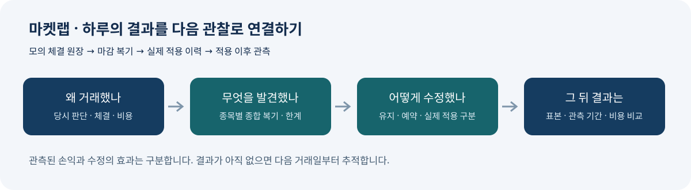

# [마켓랩 모의투자 일지] 2026-11-26 거래·성과와 전략 복기

> 2026-11-26 시장 현지 거래일 기준 모의투자 기록입니다. 캠페인은 2026년 11월 25일~12월 24일이며 국내장·미국장에 각각 1,000만 원으로 시작했습니다. 실계좌 거래나 실제 투자 수익이 아닙니다.

*직접 제작한 설명 도식. 성과 그래프가 아니라 기록의 흐름입니다.*

수익률만 남기면 왜 손익이 달라졌는지 알 수 없습니다. 체결 당시 판단, 마감 복기, 실제 수정 이력, 수정 이후 관측을 한 줄로 이어 기록합니다. 아직 없는 결과는 다음 관찰 과제로 남깁니다.

## 국내장

이날은 거래가 많았지만 손익은 나빠졌습니다. 부분 체결을 포함한 228건을 228개의 독립된 투자 판단으로 세면 문제를 잘못 읽게 됩니다. 종목별 이유와 비용, 완결 매매 표본을 함께 살펴봤습니다.

| 항목 | 결과 |
|---|---:|
| 당일 체결 | 228건 (매수 77 / 매도 151) |
| 종가 기준 평가액 | 9,327,468원 |
| 당일 평가손익 | -475,702원 (-4.85%) |
| 최초 원금 대비 누적 | -672,532원 (-6.73%) |
| 당일 매도 실현손익 | -723,036원 |
| 기록된 수수료·세금·환전 비용 | 61,700원 (상세 미기록 0건) |

종가 확인: 16/16종목, 평가까지 확인 완료. 토스 KRX·NXT 통합 일봉 종가로 시간외장 종료 후 확인했습니다. 평가손익에는 보유분 변동이 포함됩니다. 명시 비용은 이미 체결·현금 정산에 반영된 비용이므로 평가손익에서 다시 빼지 않습니다. 가격에 반영된 슬리피지도 별도 비용처럼 중복 차감하지 않습니다.

### 같은 종목의 반복 거래를 모아 보면

| 종목 | 매수/매도 체결 | 매수/매도 수량 | 매도 실현손익(원) | 기록된 명시 비용(원) |
|---|---:|---:|---:|---:|
| 아시아나IDT (267850) | 0/8 | 0/145 | -50,080 | 4,180 |
| 한진칼 (180640) | 0/1 | 0/8 | -60,128 | 4,128 |
| 삼성SDI (006400) | 2/1 | 4/4 | -50,951 | 3,951 |
| 대한항공우 (003495) | 0/2 | 0/76 | -91,468 | 4,068 |
| 포스코퓨처엠 (003670) | 1/2 | 23/23 | -110,545 | 8,945 |
| 삼아알미늄 (006110) | 1/1 | 3/3 | -1,147 | 247 |
| 까뮤이앤씨 (013700) | 0/1 | 0/46 | -872 | 136 |
| SH에너지화학 (002360) | 15/74 | 555/349 | -45,014 | 2,895 |
| 티와이홀딩스우 (36328K) | 9/15 | 94/94 | -6,758 | 678 |
| 한국화장품 (123690) | 19/18 | 1049/1049 | -197,724 | 17,754 |
| 체시스 (033250) | 1/1 | 10/10 | 7,486 | 114 |
| 삼진제약 (005500) | 12/16 | 204/204 | -78,216 | 9,116 |
| 깨끗한나라 (004540) | 10/11 | 1227/1227 | -37,619 | 4,884 |
| 미래에셋증권 (006800) | 6/0 | 199/0 | 0 | 597 |
| 두산에너빌리티 (034020) | 1/0 | 1/0 | 0 | 7 |

- **아시아나IDT**: 매수가 대비 -2.99% 하락으로 손절 기준(−2.5%) 도달 (8건). 당일 매도 실현손익 -50,080원.
- **한진칼**: 매수가 대비 -2.83% 하락으로 손절 기준(−2.5%) 도달 (1건). 당일 매도 실현손익 -60,128원.
- **삼성SDI**: 최근 분봉 +2.56% · 호가 간격 0.11% · 외국인·기관 순매도 738주 (2건); 매수가 대비 -2.67% 하락으로 손절 기준(−2.5%) 도달 (1건). 당일 매도 실현손익 -50,951원.
- **대한항공우**: 매수가 대비 -4.41% 하락으로 손절 기준(−2.5%) 도달 (2건). 당일 매도 실현손익 -91,468원.
- **포스코퓨처엠**: 매수가 대비 -2.54% 하락으로 손절 기준(−2.5%) 도달 (2건); 직전 시간 +2.00% · 최근 분봉 +4.15% · 호가 간격 0.12% · 외국인·기관 순매수 1,887주 (1건). 당일 매도 실현손익 -110,545원.
- **삼아알미늄**: 직전 시간 +3.76% · 최근 분봉 +4.82% · 호가 간격 0.28% · 외국인·기관 순매수 128주 (1건); 직전 시간 대비 -2.19%로 단기 추세 약화 (1건). 당일 매도 실현손익 -1,147원.
- **까뮤이앤씨**: 직전 시간 대비 -2.07%로 단기 추세 약화 (1건). 당일 매도 실현손익 -872원.
- **SH에너지화학**: 매수가 대비 -4.63% 하락으로 손절 기준(−2.5%) 도달 (27건); 매수가 대비 -2.67% 하락으로 손절 기준(−2.5%) 도달 (19건). 당일 매도 실현손익 -45,014원.
- **티와이홀딩스우**: 매수가 대비 -2.59% 하락으로 손절 기준(−2.5%) 도달 (15건); 직전 시간 +3.78% · 최근 분봉 +4.64% · 호가 간격 0.16% (9건). 당일 매도 실현손익 -6,758원.
- **한국화장품**: 직전 시간 +3.43% · 최근 분봉 +3.15% · 호가 간격 0.40% · 외국인·기관 순매도 29,912주 (15건); 매수가 대비 -2.58% 하락으로 손절 기준(−2.5%) 도달 (14건). 당일 매도 실현손익 -197,724원.
- **체시스**: 직전 시간 +3.58% · 최근 분봉 +3.84% · 호가 간격 0.12% · 외국인·기관 순매수 2,173주 (1건); 매수가 대비 +8.83% 상승으로 익절 기준(+5%) 도달 (1건). 당일 매도 실현손익 7,486원.
- **삼진제약**: 직전 시간 +3.70% · 최근 분봉 +4.74% · 호가 간격 0.15% · 외국인·기관 순매도 2,531주 (12건); 직전 시간 대비 -1.52%로 단기 추세 약화 (8건). 당일 매도 실현손익 -78,216원.
- **깨끗한나라**: 직전 시간 대비 -1.65%로 단기 추세 약화 (11건); 직전 시간 +6.19% · 최근 분봉 +5.49% · 호가 간격 0.17% · 외국인·기관 순매수 81,000주 (10건). 당일 매도 실현손익 -37,619원.
- **미래에셋증권**: 직전 시간 +1.79% · 최근 분봉 +1.53% · 호가 간격 0.05% · 외국인·기관 순매수 28,004주 (6건). 당일 매도 실현손익 0원 · 미매도여서 실현 결과 없음.
- **두산에너빌리티**: 직전 시간 +0.73% · 최근 분봉 +1.10% · 호가 간격 0.12% · 외국인·기관 순매수 48,275주 (1건). 당일 매도 실현손익 0원 · 미매도여서 실현 결과 없음.

이유는 체결 당시 저장된 규칙 판단입니다. 사후에 그럴듯한 투자 논리를 덧붙이지 않았습니다. 거래 시각·수량·현지 가격·비용·이유·전략 버전은 [전체 228건 체결 CSV](https://github.com/Kimkideok-Duke/kospi-paper-lab/blob/main/docs/performance/2026-11-26-kr-fills.csv)에서 확인할 수 있습니다. 한국 시간 기준이며, 실계좌 내역은 포함하지 않습니다.

### 복기에서 발견한 문제와 수정 과정

- 5분 대안 비교가 가능한 83건 중 62건은 대기 후 관측가가 가격상 유리했습니다. 실제 대안 체결 수익을 입증하지는 않습니다.
- 손절 매도 126회 체결의 순실현손익은 -605,115원입니다.
- 추세 약화 매도 24회 체결의 순실현손익은 -125,407원입니다.
- 익절 매도 1회 체결의 순실현손익은 7,486원입니다.
- 수수료·거래세·환전 비용을 포함한 순손익으로 평가합니다.
- 매도 이유별 실현손익을 비교하되 부분 체결 수를 독립 전략 표본으로 간주하지 않습니다.
- 완결 매매·거래일 표본이 부족하거나 새 완결 매매가 없어 기존 전략 유지

마감 자동 복기는 **기준 유지**로 기록됐습니다. 완결 매매·거래일 표본이 부족하거나 새 완결 매매가 없어 기존 전략 유지 확인한 완결 매매는 12회, 관측 거래일은 1일입니다. 진입 상승세 기준 0.15% → 0.15%, 최대 호가 간격 0.65% → 0.65%입니다.

해당 날짜를 근거로 한 실제 후속 적용 기록: 0건. 변경 예약·실제 적용·결과 관측을 구분하며, 유지한 날을 수정한 날로 소개하지 않습니다.

자동 복기와 별도로 실제 운영 중 적용된 변경 이력입니다. 사용자 요청에 따른 기능·설정 수정도 포함되며, 모두 복기로 자동 최적화된 결과라고 보지 않습니다.

| 적용 시각(시장 현지) | 적용 내용 | 적용 뒤 당일 관측 |
|---|---|---|
| 2026. 11. 26. 00:20:27 | paper-v3-unrestricted-allocation:3: 10분 분석 · 1분 보유 감시 · 호가 잔량 10% · 5종목 · 종목별 비중 상한 없음 · 가용 현금 내 주문 · −2.5%/+5% | 다음 변경 전까지 0건 체결 / 매도 실현손익 0원 |
| 2026. 11. 26. 02:50:07 | paper-v4-intraday-events:4: 10분 분석 · 1분 보유 감시 · 호가 잔량 10% · 5종목 · 종목별 비중 상한 없음 · 가용 현금 내 주문 · 장중 뉴스 2분/공시 1분 · −2.5%/+5% | 다음 변경 전까지 133건 체결 / 매도 실현손익 -557,002원 |
| 2026. 11. 26. 11:11:54 | paper-v5-daily-review:5: 10분 분석 · 1분 보유 감시 · 호가 잔량 10% · 5종목 · 종목별 비중 상한 없음 · 가용 현금 내 주문 · 장중 뉴스 2분/공시 1분 · −2.5%/+5% | 다음 변경 전까지 78건 체결 / 매도 실현손익 -156,154원 |
| 2026. 11. 26. 14:09:16 | paper-v6-resting-limits:6: 10분 분석 · 1분 보유 감시 · 호가 잔량 10% · 5종목 · 종목별 비중 상한 없음 · 가용 현금 내 주문 · 장중 뉴스 2분/공시 1분 · 눌림 지정가/목표가 사전 주문 · −2.5%/+5% | 다음 변경 전까지 17건 체결 / 매도 실현손익 -9,880원 |
| 2026. 11. 26. 16:26:45 | monitor-5s:7: 보유·기존 미체결 주문 감시 5초 · 신규 분석 10분 유지 · 오류 시 10~60초 대기 · 기존 주문·체결·설정 보존 | 다음 변경 전까지 0건 체결 / 매도 실현손익 0원 |

### 수정한 뒤 좋아졌는지는 아직 별도 검증이 필요하다

위 표의 변경 이후 손익은 **관측된 체결의 매도 실현손익**입니다. 전날 매수분 매도, 장중 시세·보유 구성·거래 시간 차이가 섞여 있어 변경 효과나 버전 전체 평가수익률로 해석할 수 없습니다. 같은 조건의 대조 실험도 아닙니다.

특히 5초 감시는 당일 마지막 체결 이후 적용됐습니다. 적용 후 체결은 0건이므로 성과 개선 여부는 다음 거래일부터 관찰해야 합니다. 적용 시점 뒤 새 데이터가 쌓이면 다음 일지에서 이전 판단과 연결해 다시 확인합니다.

---

## 미국장: 휴장일

저장된 토스 시장 캘린더에서 2026-11-26 정규장 일정이 없는 것을 확인했습니다. 체결은 0건입니다. 전 거래일 평가액을 새로운 종가나 오늘 수익으로 다시 계산하지 않았습니다. 전략 수정 후 결과를 관찰할 새 표본도 없습니다.

---

## 11월27일 후속 관측

전날 마지막 체결 뒤 적용해 표본이 없었던5초 감시는 다음 거래일에 실제 거래를 관측했습니다. 국내 체결186건·청산된 완결 매매13회·명시 비용34,383원, 확정 종가 평가액9,575,454원으로 직전 거래일 대비247,986원 높았습니다. 보호 매도·위험 예산 등 여러 변경과 종목·수량 차이가 함께 있어5초 감시만의 개선 효과로 해석하지 않습니다.

국내 자동 복기는 진입 상승세0.15% → 0.20%를 예약했지만 실제 후속 적용 기록은 아직0건입니다. −7% 손절은 국내 정규장 마감 후 변경돼 그 뒤 당일 체결도 없었습니다. [11월27일 후속 일지](https://velog.io/@kkd9013/marketlab-paper-2026-11-27)에서 당시 판단·실제 수정·적용 이후 관측을 구분했습니다.

[한 달 기록과 산정 기준](https://github.com/Kimkideok-Duke/kospi-paper-lab/blob/main/docs/performance/README.md) · [개발 기획 의도](https://velog.io/@kkd9013/marketlab-01-planning-intent)
