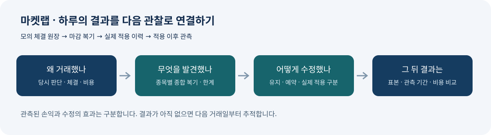

# [마켓랩 모의투자 일지] 2026-11-27 손실 일부 회복과 매도 방식 보완

> 2026-11-27 각 시장 현지 거래일의 모의투자 기록입니다. 국내·미국 계좌는 각각 최초 원금 1,000만 원으로 시작했습니다. 실계좌 거래나 실제 투자 수익이 아닙니다. 2026-11-28 한국 시간에 저장된 마감 자료를 읽기 전용으로 확인했습니다.

전날의 손실을 일부 회복한 날이었습니다. 국내는 직전 확정 평가액보다 +247,986원, 미국은 +92,904원 높게 마감했습니다. 다만 원금 대비로는 두 시장 모두 손실이 남아 있습니다. 하루의 반등과 전략 수정의 효과를 같은 결론으로 묶지 않으려 합니다.

이날은 한 주씩 반복되던 보호 매도의 처리와 화면 표시를 보완했고, 신규 주문의 위험 예산도 줄였습니다. 손절 폭을 넓힌 변경은 국내 정규장이 끝난 뒤 적용됐습니다. 무엇을 고쳤는지보다 먼저, 그 변경 뒤에 실제로 관측한 거래가 있었는지를 구분해 봤습니다.

*기존 구현을 설명하기 위해 직접 제작한 도식입니다. 실제 성과를 그린 이미지가 아닙니다.*

## 국내장: 반등했지만 누적 손실은 남아 있다

| 항목 | 확인 결과 |
|---|---:|
| 당일 체결 | 186건 (매수 16 / 매도 170) |
| 체결이 발생한 주문 | 30개 (주문 식별 미기록 0건) |
| 당일 청산된 완결 매매 | 13회 |
| 확정 종가 평가액 | 9,575,454원 |
| 직전 거래일 대비 평가손익 | +247,986원 (+2.66%) |
| 최초 원금 대비 누적 | -424,546원 (-4.25%) |
| 당일 매도 실현손익 | +277,887원 |
| 기록된 수수료·세금·환전 비용 | 34,383원 (상세 미기록 0건) |
| 마감 시점 보유 종목 | 3개 |

직전 기준은 11월26일 확정 평가액 9,327,468원입니다. 11월27일에는 토스 KRX·NXT 통합 일봉 종가를 시간외장 종료 후 확인했고, **14/14종목의 가격과 평가가 모두 완료**됐습니다. 확인 시각은 한국 시간 2026-11-27 20:02:05입니다. 원래 복기 보고서의 마지막 저장 평가액을 새 종가로 사용하지 않았습니다.

평가손익에는 남은 보유분 변동이 포함됩니다. 매도 실현손익은 별도 관점의 수치이므로 둘을 더하지 않습니다. 명시 비용은 이미 현금 정산과 손익에 반영돼 있어 다시 빼지 않으며, 체결가격에 들어간 슬리피지도 별도로 이중 차감하지 않습니다.

### 같은 종목의 체결을 묶어 읽기

| 종목 | 매수/매도 체결 | 매수/매도 수량 | 매도 실현손익 | 명시 비용 |
|---|---:|---:|---:|---:|
| 까뮤이앤씨 (013700) | 0/85 | 0/1394 | -80,384원 | 3,997원 |
| SH에너지화학 (002360) | 0/68 | 0/206 | -29,454원 | 1,503원 |
| 현대오토에버 (307950) | 1/2 | 6/6 | -40,059원 | 5,059원 |
| NHN (181710) | 3/5 | 44/44 | +120,674원 | 6,026원 |
| 삼성에스디에스 (018260) | 0/1 | 0/10 | -19,124원 | 4,124원 |
| 미래에셋증권 (006800) | 0/2 | 0/199 | +191,436원 | 8,947원 |
| TIGER 반도체TOP10레버리지 (488080) | 1/1 | 95/95 | -17,455원 | 355원 |
| KODEX 코스닥150레버리지 (233740) | 2/2 | 542/542 | +41,074원 | 736원 |
| KODEX SK하이닉스단일종목레버리지 (0193T0) | 1/1 | 348/348 | +65,748원 | 372원 |
| KODEX 반도체레버리지 (494310) | 5/1 | 81/41 | +59,767원 | 553원 |
| 한화에어로스페이스 (012450) | 1/0 | 1/0 | 0원 | 99원 |
| TIGER SK하이닉스단일종목레버리지 (0195S0) | 1/0 | 391/0 | 0원 | 183원 |
| 두산에너빌리티 (034020) | 0/1 | 0/1 | +2,000원 | 93원 |
| 한진칼 (180640) | 1/1 | 4/4 | -16,336원 | 2,336원 |

까뮤이앤씨와 SH에너지화학은 당일 신규 매수 없이 이전 보유분을 손절한 종목입니다. 각각 85건과 68건의 부분 체결이었지만, 그만큼 서로 다른 투자 판단을 한 것은 아닙니다. 저장된 이유에는 당시 적용되던 −2.5% 손절 기준이 남아 있으며, 새 −7% 기준을 과거 거래에 소급하지 않았습니다.

NHN은 분봉 상승세·호가 간격·수급을 근거로 진입했고 목표가 사전 주문으로 매도했습니다. 미래에셋증권과 두산에너빌리티도 저장된 매도 이유가 목표가 도달이지만, 이 두 종목에는 이전 거래일에 사둔 물량이 포함됩니다. 당일 신규 진입의 성공과 이전 보유분의 회복을 분리해서 읽어야 합니다.

KODEX 코스닥150레버리지는 눌림 지정가 매수 뒤 목표가와 추세 약화 청산이 함께 기록됐습니다. KODEX SK하이닉스단일종목레버리지는 목표가 매도로 마무리했고, KODEX 반도체레버리지는 일부를 목표가에 매도한 뒤 잔량이 남았습니다. ETF라는 이유만으로 위험이 낮다고 판단하지 않으며, 레버리지 상품의 성과를 일반 주식과 같은 변동성으로 비교하지 않습니다.

현대오토에버·삼성에스디에스·한진칼·TIGER 반도체TOP10레버리지의 매도 사유는 단기 추세 약화였습니다. 현대오토에버의 초기 진입에는 강한 상승세에 즉시 체결을 우선한 기록이 있습니다. 이후 보호 매도와 진입 제한을 보완했지만, 이 손실만으로 다른 진입 방식의 수익을 만들어 비교하지는 않습니다.

한화에어로스페이스와 TIGER SK하이닉스단일종목레버리지는 눌림 가격으로 매수한 뒤 당일 매도가 없었습니다. 남은 KODEX 반도체레버리지와 함께 마감 보유분 세 종목을 구성합니다. 표의 실현손익 0원은 수익도 손실도 없다는 뜻이 아니라 아직 매도 실현 결과가 없다는 뜻입니다.

체결별 현지 시각·수량·가격·비용·저장된 판단 이유·전략 버전은 [전체 186건 CSV](https://github.com/Kimkideok-Duke/kospi-paper-lab/blob/main/docs/performance/2026-11-27-kr-fills.csv)에 제공합니다. 사용자·계좌·주문·원장 식별값은 제외했습니다. 종목 선정 이유는 당시 저장된 규칙 판단이며, 별도 확인하지 않은 뉴스나 기업 실적 설명을 사후에 붙이지 않았습니다.

### 복기: 손절 뒤 반등을 봤다는 이유만으로 기다리는 편이 낫다고 할 수는 없다

당시 저장된 5분 비교가 가능한 체결은 83건이고, 그중 57건은 기다린 뒤 관측 가격이 유리했습니다. 그러나 나머지 체결에는 같은 비교 자료가 없고 부분 체결도 섞여 있습니다. 이 가격 차이를 합쳐 대안 전략의 수익률로 계산하지 않았습니다.

마감 후 하루 분봉도 14종목 모두 보완돼 있습니다. 까뮤이앤씨의 첫 매도 표본은 이후 마지막 분봉 가격이 체결가보다 2.77% 높았습니다. 반면 SH에너지화학의 첫 매도 표본은 추가 하락 뒤 반등했고 마지막 분봉은 체결가보다 0.29% 낮았습니다. 두 사례를 함께 보면 반등 장면만으로 모든 손절을 늦추는 결론을 내리기 어렵습니다.

이 수치는 각 종목의 첫 매도 한 건을 기준으로 한 사후 표본입니다. 봉 내부의 고저가 순서, 그 시점의 호가와 동일 수량 체결 가능성, 추가 비용과 재진입을 재현하지 않았습니다. 다음 검증에서는 눌림 지정가 진입과 반등 확인 뒤 재진입 같은 가설을 비교할 수 있지만, 이번 일지에서 더 나은 매매가 입증됐다고 쓰지는 않습니다.

### 실제 수정 이력과 그 뒤 관측

| 적용 시각(한국 시간) | 실제 변경 | 다음 변경 전 체결 | 그 구간 매도 실현손익 |
|---|---|---:|---:|
| 09:00~09:25:26 | 기존 전략·5초 감시 | 95건 | -121,688원 |
| 09:25:26 | v7: 보호 매도 잔량의 새 호가 재평가, 손절 후30분 재진입 대기 등 | 16건 | -21,249원 |
| 09:31:28 | v8: 종목당15%·총투자60% 상한과1회 손실 예산0.35%, 일손실1% 신규매수 중지 | 47건 | -14,183원 |
| 09:40:54 | v9: 보호 매도의 관측 잔량100% 사용과 동일 호가 잔량 중복 사용 차단 | 28건 | +435,007원 |
| 16:25:07 | v10: 손절−2.5% → −7%, 주문 수량의 위험 계산에도7% 반영 | 0건 | 관측 체결 없음 |

표는 실제 저장된 적용 시각으로 나눈 **관측 구간**입니다. 각 구간에 새로 산 물량뿐 아니라 이전 보유분의 매도도 들어 있습니다. 특히 v9 이후 양의 실현손익에는 이전 보유분의 목표가 매도가 섞여 있어, 체결 방식 변경이 이익을 만들었다고 해석할 수 없습니다. 기존 체결 기록을 지우거나 새 기준으로 다시 쓰지 않았습니다.

11월26일과 비교하면 부분 체결은 228건에서186건, 기록된 명시 비용은61,700원에서34,383원으로 줄었습니다. 당일 청산된 완결 매매는12회에서13회였습니다. 거래한 종목·물량·장중 구간이 다르고 여러 변경도 겹쳤으므로 비용 감소나 손익 반등을5초 감시 하나의 효과로 분리할 수는 없습니다. 전날 적용 뒤 표본이 없었던5초 감시는 이날 실제 거래를 관측한 단계까지 진행됐습니다.

−7% 손절은 국내 정규장 종료 뒤 적용됐고 그 뒤 당일 체결은0건입니다. **국내의 이날 반등은 새 −7% 손절의 검증 결과가 아닙니다.** 적용 후 결과는 다음 실제 거래일의 관찰 과제입니다. 일손실 매수 중지는 코드의 기준이며, 마감 시점에 저장된 국내 위험 세션의 중지 상태는 false였습니다.

근거: [보호 매도 보완 c0fe2d4](https://github.com/Kimkideok-Duke/kospi-paper-lab/commit/c0fe2d4), [위험 예산 455546a](https://github.com/Kimkideok-Duke/kospi-paper-lab/commit/455546a), [잔량 처리 6a44611](https://github.com/Kimkideok-Duke/kospi-paper-lab/commit/6a44611), [손절 폭 b98a3c9](https://github.com/Kimkideok-Duke/kospi-paper-lab/commit/b98a3c9). [개발기03편](https://velog.io/@kkd9013/marketlab-devlog-2026-11-27)에는 구현과144개 코드 검증의 범위를 정리했습니다. 테스트 통과는 수익 개선의 입증과 구분합니다.

### 자동 복기는 변경을 예약했지만 아직 적용하지 않았다

마감 자동 복기는 최근 최대20회 완결 매매에서 순손실−131,781원, 손실 비율65%를 확인하고 진입 상승세 기준을 **0.15% → 0.20%**로 강화하도록 예약했습니다. 관측 거래일은2일이고, 그날 청산한 완결 매매는13회입니다. 이20회 표본은 당일 전체 매도 실현손익 합계와 다른 범위입니다.

자동 정책의 최대 호가 간격0.65%는 변경하지 않았습니다. 별도로 v8 위험 관리의 진입 호가 간격 상한0.2%도 적용되므로, 정책 표의0.65%가 최종 진입 허용 폭이라는 뜻은 아닙니다. 손절·익절·비중·비용을 마감 자동 복기가 바꾼 것은 아닙니다.

이 복기 날짜에 연결된 실제 후속 적용 기록은 **0건**입니다. 저장된 다음 거래일은11월30일이며, 다음 유효 거래일에 적용하는 예약 단계입니다. 아직 새0.20% 기준으로 거래한 결과는 없습니다.

## 미국장: 조기 마감한 날, 이전 보유분의 익절과 새 진입

| 항목 | 확인 결과 |
|---|---:|
| 당일 체결 | 6건 (매수 3 / 매도 3) |
| 체결이 발생한 주문 | 5개 (주문 식별 미기록 0건) |
| 당일 청산된 완결 매매 | 2회 |
| 확정 종가 평가액 | 9,920,034원 |
| 직전 거래일 대비 평가손익 | +92,904원 (+0.95%) |
| 최초 원금 대비 누적 | -79,966원 (-0.80%) |
| 당일 매도 실현손익 | +166,378원 |
| 기록된 수수료·세금·환전 비용 | 16,119원 (상세 미기록 0건) |
| 마감 시점 보유 종목 | 5개 |

저장된11월27일 미국 시장 캘린더의 정규장은 **미국 동부 시간09:30~13:00**입니다. 한국 시간으로는11월27일23:30~11월28일03:00에 해당합니다. 전 거래일은11월25일이며,11월26일은 저장 캘린더로 확인한 휴장이므로 이날 일간 손익은11월25일 확정 평가액 9,827,130원과 비교했습니다.

정규장 일봉 종가는 **7/7종목 모두 확인**했고 평가 상태도 완료입니다. 환율은 마감 이전에 저장된1USD당1,337.8원을 사용했습니다. 저장 시각은 미국 동부12:46:01입니다. 주가와 환율이 함께 반영되는 원화 평가액이며, 환율을 별도로 새 조회하거나 더 유리한 값으로 고르지 않았습니다.

### 종목별 판단과 결과

| 종목 | 매수/매도 체결 | 매수/매도 수량 | 매도 실현손익 | 명시 비용 |
|---|---:|---:|---:|---:|
| 아날로그 디바이스 (ADI) | 0/2 | 0/4 | +106,567원 | 7,348원 |
| 코히런트 (COHR) | 1/0 | 1/0 | 0원 | 568원 |
| GDX (GDX) | 1/0 | 2/0 | 0원 | 416원 |
| 디어 (DE) | 0/1 | 0/2 | +59,811원 | 7,079원 |
| 네비우스 그룹 (NBIS) | 1/0 | 3/0 | 0원 | 708원 |

아날로그 디바이스는 이전 보유4주를 두 번에 나눠 익절했고, 디어도 이전 보유2주를 목표가 주문으로 매도했습니다. 두 종목을 합친 매도 실현손익은 +166,378원입니다. 당일 새로 산 물량을 곧바로 팔아 얻은 결과로 소개하지 않습니다.

코히런트·GDX·네비우스 그룹은 최근 분봉 상승세와 호가 간격을 확인하고 눌림 지정가 방식으로 매수했습니다. 이날 매도한 기록은 없으며, 다른 보유분과 함께 총5종목이 마감 평가에 남아 있습니다. 신규 진입의 최종 결과는 아직 관찰 중입니다.

전체 체결은 [미국장6건 CSV](https://github.com/Kimkideok-Duke/kospi-paper-lab/blob/main/docs/performance/2026-11-27-us-fills.csv)에 제공합니다. 체결가격은USD, 현금 정산·비용·실현손익은KRW이며 거래별 당시 환율을 함께 기록했습니다. 마감 평가는 위에 적은 마감 이전 저장 환율을 사용하므로 거래 시점 환율과 구분합니다.

### 수정 이후의 관측과 유지 결정

공통 v10 변경은 미국 동부11월27일02:25:35에 버전 기록이 남았고, 이날 정규장6건 체결은 그 뒤에 관측됐습니다. 두 번의 완결 매매는 익절한 이전 보유분이고 손절 매도는 없었습니다. 따라서−7% 손절의 방어 성과를 검증할 표본은 아닙니다.

11월25일에는31건 체결·매도 실현손익−246,792원·명시 비용78,274원이었고, 이날은6건·+166,378원·16,119원입니다. 전 거래일 이후 보유 구성과 거래 시간도 달랐습니다. 이날은 조기 마감이어서 관측 구간도 짧았으므로 수치 차이를 수정 효과로 단정할 수 없습니다.

미국 자동 복기는 변경 조건을 충족하지 않아 기존 기준을 유지했습니다. 확인한 완결 매매는9회, 관측 거래일은2일이며 진입 상승세0.15%·자동 정책 최대 호가 간격0.65%는 그대로입니다. 이 복기 날짜를 근거로 한 후속 자동 적용 기록은0건입니다. 당일6건 모두5분 후 관측 비교가 있었고3건은 기다린 가격이 유리했지만, 그것 역시 같은 수량의 체결을 보장하는 대안 수익은 아닙니다.

## 다음 기록에서 이어 볼 내용

국내는0.20% 진입 기준의 예약이 실제 적용됐는지부터 확인하고, 이후 신규 진입과 이전 보유분의 청산을 구분해 관측하겠습니다. 국내−7% 손절 변경 후에는 아직 당일 거래 표본이 없고, 미국도 새 손절 기준이 작동한 사례는 없었습니다. 현재 긍정적인 하루 결과만으로 두 변경의 우위를 결정할 수 없습니다.

종가 감사의 완료 상태·평가액·현지 시각을 확인했고, 원장 합계와 공개 CSV의 건수·실현손익·기록된 비용을 대조했습니다. CSV는 허용 필드만 사용하고 텍스트 필드의 수식 실행 방지와 표준 인용을 적용했습니다. 이번 일지 작성은 원장 읽기와 문서 집계만 수행했으며 전략 변경·수동 매매·실제 주문은 실행하지 않았습니다.

[11월26일 일지](https://velog.io/@kkd9013/marketlab-paper-2026-11-26) · [11월25일 첫 기록](https://velog.io/@kkd9013/marketlab-paper-2026-11-25) · [한 달 기록과 산정 기준](https://github.com/Kimkideok-Duke/kospi-paper-lab/blob/main/docs/performance/README.md) · [기획 의도](https://velog.io/@kkd9013/marketlab-01-planning-intent)
